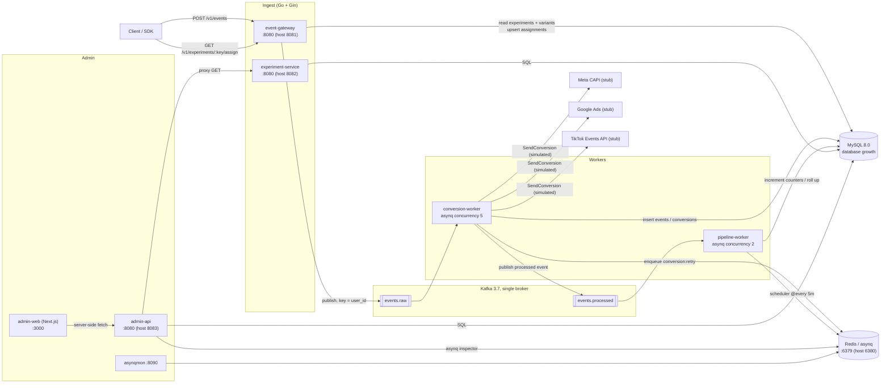
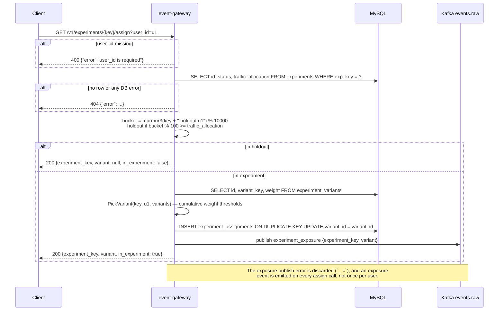
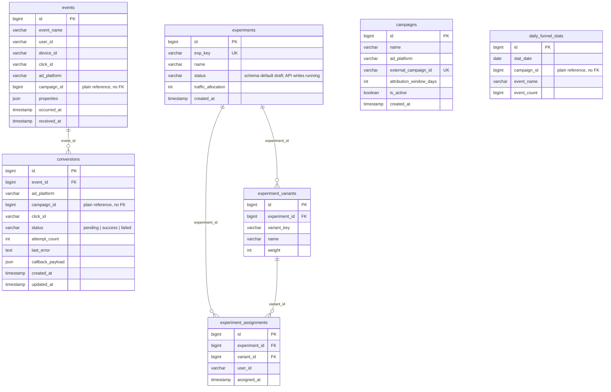
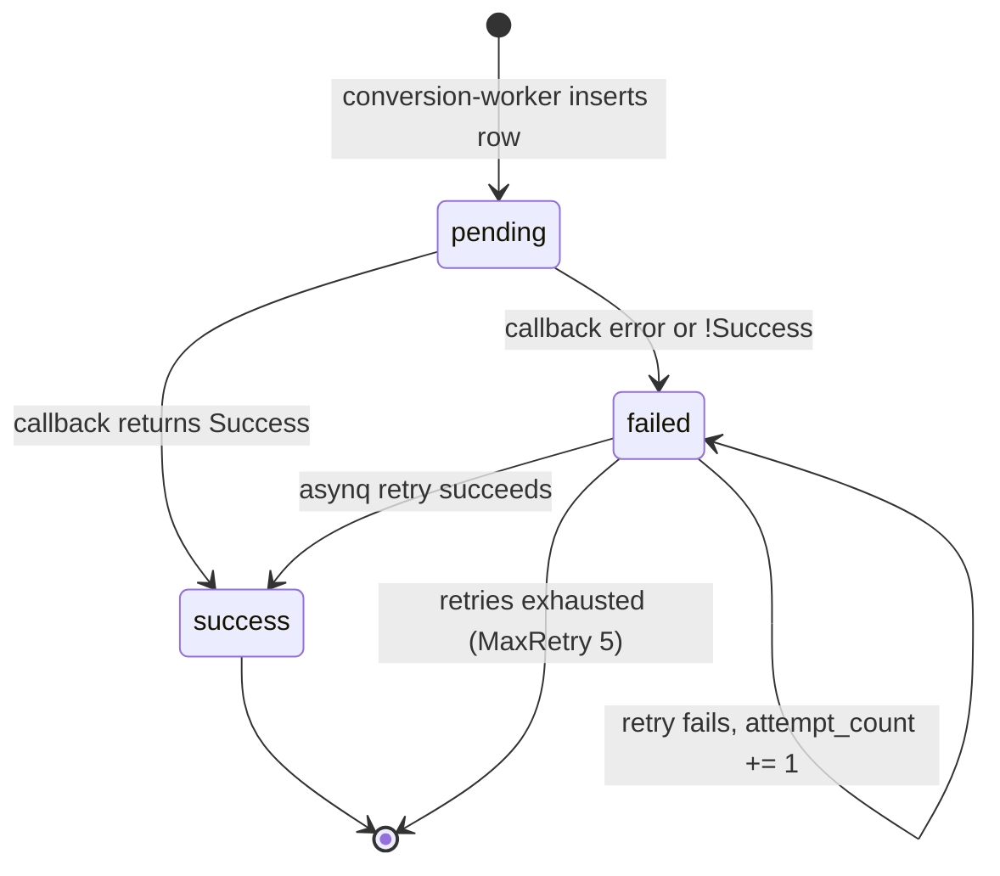

# meshy-growth-backend

[English](README.md) | [简体中文](README.zh-CN.md)

A Go growth-infrastructure prototype: Kafka-based event ingestion, server-side conversion
callbacks to Meta / Google / TikTok, deterministic A/B bucketing with Wilson intervals and
SRM checks, and a Next.js admin console. Six Go services share one MySQL schema and start
with a single `docker compose up`.

> **Prototype, not production.** The ad-platform clients build the real request bodies but
> never send them (`internal/adplatform/client.go:46-55`). No endpoint has authentication.
> `daily_funnel_stats` is written by `pipeline-worker` but never read by any API. Each case
> is called out below.

---

## Overview

Growth teams need three answers: what users do, whether a conversion can be credited to the
ad that produced it, and whether a product change moved a metric. This repo wires all three
into one small stack:

| Problem | Component | Storage |
|---|---|---|
| Event collection | `event-gateway` → Kafka `events.raw` → `conversion-worker` | `events` |
| Conversion attribution | `conversion-worker` + `internal/adplatform` + asynq retries | `conversions` |
| A/B assignment and readout | `event-gateway` (bucketing) + `experiment-service` (stats) | `experiments*` |
| Daily funnel counters | `pipeline-worker` | `daily_funnel_stats` |
| Operations UI | `admin-api` + `admin-web` | read models |

It mirrors Segment/RudderStack (pipelines), Meta CAPI / Google Ads / TikTok Events API
(conversion upload) and GrowthBook/Statsig (assignment + statistics). The behaviour is real,
the outbound ad calls are simulated, and the audience is engineers wanting a runnable,
inspectable example — there is no multi-tenant model.

---

## Table of Contents

- [Features](#features)
- [Architecture](#architecture)
- [Key flows](#key-flows)
- [Data model](#data-model)
- [Directory layout](#directory-layout)
- [Getting started](#getting-started)
- [Commands](#commands)
- [Configuration](#configuration)
- [API](#api)
- [Deployment](#deployment)
- [Troubleshooting](#troubleshooting)
- [Design decisions & limitations](#design-decisions--limitations)
- [FAQ](#faq)
- [License](#license)

---

## Features

**Event ingestion**
- `POST /v1/events` requires `event_name`/`user_id`, stamps `received_at` and returns
  `202 {"status":"queued"}` after publishing to Kafka keyed by `user_id`
  (`cmd/event-gateway/main.go:48-74,117`); `occurred_at` defaults to UTC now (`:54-57`).
- Offsets commit only after the worker's DB writes succeed
  (`cmd/conversion-worker/main.go:81-87`).

**Conversion callbacks**
- A conversion row is created only when `click_id`, `campaign_id` and `ad_platform` are all
  present (`cmd/conversion-worker/main.go:111-119`).
- Platform builders cover Meta CAPI, Google Ads click upload (with the non-RFC3339
  `yyyy-MM-dd HH:mm:ss+HH:MM` datetime) and TikTok Events API (`internal/adplatform/*.go`).
- The generated body is kept in `conversions.callback_payload`; failures retry through asynq
  with a 10 s delay, `MaxRetry(5)` and a 30 s timeout (`cmd/conversion-worker/main.go:221-233`).

**A/B experiments**
- Deterministic murmur3 bucketing over `experimentKey + ":" + userId` in `[0, 10000)`
  (`internal/experiment/experiment.go:9-12`), weighted cumulative thresholds (`:21-39`).
- The holdout hash uses the separate salt `expKey + ":holdout"`, so changing
  `traffic_allocation` does not reshuffle users already in a variant
  (`cmd/event-gateway/main.go:130`).
- Assignment is insert-once per `(experiment_id, user_id)` (`:159-162`).
- Stats return counts, conversion rate, a 95% Wilson interval, a two-proportion z-test
  p-value against the first variant, and a chi-square SRM check flagged at `p < 0.01`
  (`cmd/experiment-service/main.go:197-265`).

**Operations console**
- Four sections — Events, Conversions, Experiments, Campaigns
  (`admin-web/components/NavBar.tsx:3-8`) — rendered as Next.js server components; campaign
  creation is a server action (`admin-web/app/campaigns/page.tsx:7-27`), and the conversions
  page shows status counts, queue depth and the latest 100 rows
  (`admin-web/app/conversions/page.tsx:13-18`).

**Testing and validation**
- Go unit tests for bucketing (`internal/experiment/experiment_test.go`) and statistics
  against hand-checked values and a real 288k-row dataset
  (`cmd/experiment-service/stats_test.go`); `testdata/` adds an offline aggregator and a
  live replay tool (CSV gitignored).

---

## Architecture



| Layer | Path | Responsibility |
|---|---|---|
| Ingest HTTP | `cmd/event-gateway` | `POST /v1/events`, `GET /v1/experiments/:key/assign`; publishes to Kafka, reads/writes experiment tables directly |
| Conversion worker | `cmd/conversion-worker` | Consumes `events.raw`, writes `events` + `conversions`, calls ad clients, enqueues retries, republishes to `events.processed` |
| Pipeline worker | `cmd/pipeline-worker` | Consumes `events.processed` to increment `daily_funnel_stats`; 5-minute scheduler reconciles |
| Experiment HTTP | `cmd/experiment-service` | Experiment create/list/get, stats, Wilson CI, p-value, SRM |
| Admin HTTP | `cmd/admin-api` | Read models over MySQL, campaign create, asynq queue status, proxy to experiment-service |
| Admin UI | `admin-web/` | Next.js 15 server components, four pages plus experiment detail |
| Ad adapters | `internal/adplatform` | Platform payload builders behind one `Client` interface; `simulateOutcome` replaces HTTP |
| Bucketing | `internal/experiment` | Pure `Bucket` / `PickVariant` functions |
| Migration / infra | `cmd/migrate` + `migrations/`; `docker-compose.yml` | golang-migrate `Up()` of `0001_init`; MySQL 8.0, Redis 7, Kafka 3.7 (KRaft), asynqmon, seed |

Host ports come from `docker-compose.yml:76,126,142,155,166,13,25,47`. Inside the compose
network each HTTP service listens on `:8080`; only host ports differ.

One mismatch with the other docs: `docs/02-architecture.md:52` draws
`event-gateway → experiment-service` for bucketing, but the gateway queries MySQL directly
(`cmd/event-gateway/main.go:120-167`) and never calls `experiment-service`. The rest of that
diagram matches the code.

---

## Key flows

### 1. Event ingestion and where deduplication happens

The ingest path has **no idempotency key**: every accepted `POST /v1/events` becomes a new
row. Deduplication is deferred — assignments are unique per `(experiment_id, user_id)`,
statistics use `COUNT(DISTINCT user_id)`, and ad platforms receive `event_id` as their match
key.

```mermaid
sequenceDiagram
    participant C as Client
    participant EG as event-gateway
    participant K as Kafka events.raw
    participant CW as conversion-worker
    participant DB as MySQL
    participant K2 as Kafka events.processed
    C->>EG: POST /v1/events {event_name, user_id, click_id?, ad_platform?, campaign_id?, properties?}
    EG->>EG: ShouldBindJSON — event_name and user_id required
    EG->>EG: occurred_at = now(UTC) if missing; received_at = now(UTC)
    EG->>K: Publish(key=user_id, JSON), 5 s timeout
    alt publish failed
        EG-->>C: 500 {"error": ...}
    else publish ok
        EG-->>C: 202 {"status":"queued"}
    end
    K-->>CW: FetchMessage (manual commit)
    CW->>DB: INSERT INTO events
    CW->>K2: publish processed event (best effort, 5 s timeout)
    alt click_id != "" and campaign_id != 0 and ad_platform != ""
        CW->>DB: INSERT INTO conversions (status='pending')
        CW->>CW: sendConversion(...)
    end
    CW->>K: CommitMessages only if handleEvent returned nil
    Note over CW,DB: No unique key on events. Re-delivery after a crash creates<br/>a second row; recorded as a known gap in docs/01-build-sop.md ADR-001.
```

If `handleEvent` fails the loop logs and continues **without committing**
(`cmd/conversion-worker/main.go:81-84`); kafka-go has already advanced its in-process reader,
so replay from the last committed offset only happens after a restart.

### 2. Conversion callback and retry

`sendConversion` never performs an HTTP request: the client serialises the body and calls
`simulateOutcome`, which fails 15% of the time (`internal/adplatform/client.go:50-55`). Every
attempt increments `attempt_count` and stores the would-be body in `callback_payload`.

```mermaid
sequenceDiagram
    participant CW as conversion-worker
    participant DB as MySQL
    participant AP as adplatform.Client
    participant R as Redis / asynq
    participant RW as asynq worker
    CW->>DB: INSERT conversions (status='pending')
    CW->>AP: ForPlatform(ad_platform) then SendConversion(event)
    AP->>AP: build payload, simulateOutcome() — no network
    alt Result.Success
        CW->>DB: UPDATE status='success', attempt_count+1, callback_payload
    else failure or err
        CW->>DB: UPDATE status='failed', attempt_count+1, last_error, callback_payload
        CW->>R: Enqueue "conversion:retry" {conversion_id}<br/>ProcessIn 10s, MaxRetry 5, Timeout 30s
        Note over CW: handleEvent returns the enqueue result, so the Kafka<br/>offset is committed once the retry task is queued.
        R->>RW: deliver after 10 s
        RW->>DB: SELECT conversion + its event
        RW->>AP: SendConversion again
        alt success on retry
            RW->>DB: UPDATE status='success', attempt_count+1
        else still failing
            RW->>DB: UPDATE status='failed', attempt_count+1
            Note over R,RW: asynq re-delivers until MaxRetry is exhausted;<br/>the row then stays 'failed'.
        end
    end
```

`retryConversion` rebuilds the event from `events` instead of trusting the task payload, so
a task only needs the conversion id (`cmd/conversion-worker/main.go:172-206`).

### 3. A/B assignment and exposure logging

Bucketing runs in the gateway against MySQL. `traffic_allocation` is an integer percentage;
the holdout hash is salted differently from the variant hash so allocation changes are
independent of membership. `TestBucketHoldoutSaltIsIndependent` asserts they diverge
(`internal/experiment/experiment_test.go:18-36`).



The returned variant is recomputed on every request from the current weights, while the
stored assignment is insert-once. Editing variant weights can therefore make the response
and the persisted row disagree until the experiment is recreated.

**Admin console path:** async server components call `fetchJSON` with `cache: "no-store"`
(`admin-web/lib/api.ts:1-11`); `admin-api` reads MySQL and proxies experiment routes to
`experiment-service`, passing status and body through (`cmd/admin-api/main.go:187-220`).

---

## Data model

Everything is created by `migrations/0001_init.up.sql`. Only these foreign keys exist:
`campaigns` is **not** referenced by FK from `events`, `conversions` or `daily_funnel_stats`.



Indexes serve the hot reads and upserts: `idx_events_click_id`, `idx_events_campaign`,
`idx_events_user_name_time` and `idx_events_received_at` on `events`,
`idx_conversions_status` / `idx_conversions_campaign`, `uniq_experiment_user` on
assignments, and `uniq_daily_stat` on `daily_funnel_stats`
(`migrations/0001_init.up.sql:12-84`).

### Conversion lifecycle



`pending` exists only between the insert and the first synchronous send, both inside
`handleEvent` (`cmd/conversion-worker/main.go:116-131`); no polling loop touches it.

### Experiment status

`experiments.status` has no lifecycle: the schema default is `draft`
(`migrations/0001_init.up.sql:50`), `POST /v1/experiments` inserts `running`
(`cmd/experiment-service/main.go:96`), no endpoint updates it, and `assignVariant` selects
the column without checking it (`cmd/event-gateway/main.go:124-128`). Every experiment row
therefore serves assignments regardless of status.

---

## Directory layout

```text
meshy-growth-backend/
├─ cmd/
│  ├─ event-gateway/        # POST /v1/events, GET /v1/experiments/:key/assign
│  ├─ conversion-worker/    # Kafka consumer, DB writes, ad callbacks, retries
│  ├─ pipeline-worker/      # funnel counters + 5-minute reconciliation
│  ├─ experiment-service/   # experiment CRUD + stats (stats.go, stats_test.go)
│  ├─ admin-api/            # admin read models, campaign create, proxy
│  ├─ migrate/              # golang-migrate Up()
│  └─ seed/                 # demo campaigns, experiment, 200 simulated users
├─ internal/
│  ├─ adplatform/           # Client interface + meta/google/tiktok builders + stub outcome
│  ├─ config/ · db/         # env defaults; MySQL connect with retry + migrate wrapper
│  ├─ experiment/           # murmur3 Bucket + PickVariant (+ tests)
│  ├─ httpserver/ · kafka/  # gin SIGTERM drain (15 s); kafka-go producer/consumer
│  └─ models/ · queue/      # row structs; asynq client/server/scheduler + task types
├─ migrations/              # 0001_init up/down, 7 tables
├─ admin-web/               # Next.js 15 App Router console (Tailwind, vitest)
│  ├─ app/                  # /, /events, /conversions, /campaigns, /experiments, /experiments/[key]
│  ├─ components/ · lib/    # NavBar, RefreshButton (+ tests); fetchJSON + types
│  └─ Dockerfile            # standalone output → node server.js
├─ docs/ · testdata/        # 9 numbered Chinese docs + index; Udacity A/B tooling (CSV gitignored)
├─ Dockerfile · docker-compose.yml
├─ .env.example · go.mod
```

---

## Getting started

### Option A — Docker Compose

Requires Docker Desktop with Compose v2. No local Go or Node.

```bash
git clone https://github.com/Ethan-upgrade/meshy-growth-backend.git
cd meshy-growth-backend
docker compose build
docker compose up -d
docker compose ps                    # mysql/redis/kafka should be "healthy"
curl -s http://localhost:8081/healthz http://localhost:8082/healthz http://localhost:8083/healthz

docker compose run --rm seed         # 200 users, 3 campaigns, 1 experiment
# open http://localhost:3000         # admin-web redirects to /events
```

`migrate` is a one-shot service: it waits for MySQL's healthcheck, applies `0001_init`,
exits 0, and business services wait for `service_completed_successfully`
(`docker-compose.yml:54-64,77-79`). `seed` is behind the `seed` profile, so plain `up`
skips it.

```bash
curl -X POST http://localhost:8081/v1/events \
  -H "Content-Type: application/json" \
  -d '{"event_name":"purchase","user_id":"tutorial-user-1","click_id":"demo-click-1",
       "ad_platform":"meta","campaign_id":1,"properties":{"value":199}}'
# {"status":"queued"}
```

### Option B — run a service directly

Requires Go 1.25 plus reachable MySQL/Redis/Kafka (the compose stack works; host ports are
3306, 6380, 9092). The config defaults point at compose hostnames, so override them:

```bash
export MYSQL_DSN='app:app@tcp(127.0.0.1:3306)/growth?parseTime=true&multiStatements=true'
export REDIS_ADDR='127.0.0.1:6380'
export KAFKA_BROKERS='127.0.0.1:9092'
MIGRATIONS_PATH=./migrations go run ./cmd/migrate
HTTP_ADDR=:8080 go run ./cmd/event-gateway
```

The image copies `migrations/` to `/app/migrations`, which is why `MIGRATIONS_PATH` defaults
there; a local run must set it explicitly.

### admin-web outside Docker

```bash
cd admin-web
npm install
ADMIN_API_URL=http://localhost:8083 npm run dev   # http://localhost:3000
```

`ADMIN_API_URL` is read on the server at request time (`admin-web/lib/api.ts:1`) and never
reaches the browser.

### Build

```bash
go build ./cmd/...                    # all seven Go binaries
docker compose build                  # one distroless image per service
cd admin-web && npm run build         # standalone Next build
```

There is **no CI configuration** in this repository (no `.github/`, no pipeline file), so
none of these steps run automatically.

---

## Commands

| Command | What it does |
|---|---|
| `docker compose build` | Builds images; each uses `ARG SERVICE` to select `./cmd/<service>` |
| `docker compose up -d` | Starts infra, migrate, gateway, workers, experiment-service, admin-api, asynqmon, admin-web |
| `docker compose ps` / `logs -f <svc>` | Status; follow logs |
| `docker compose run --rm seed` | Seeds 3 campaigns, `checkout_button_color`, 200 users |
| `docker compose restart <svc>` | Rolling restart; logs `shutting down gracefully` |
| `docker compose down -v` | Stops everything and deletes the `mysql-data` volume |
| `go test ./...` | Unit tests for `internal/experiment` and `cmd/experiment-service` |
| `go run ./cmd/{migrate,event-gateway,conversion-worker,pipeline-worker,experiment-service,admin-api,seed}` | Runs one service locally |
| `cd testdata && go run compute_stats.go` | Offline aggregation of `ab_data.csv` |
| `cd testdata && go run replay_ab_dataset.go -sample 3000` | Live replay, then stats diff |
| `cd admin-web && npm run dev` / `build` | Next dev / production build |
| `cd admin-web && npm run lint` / `type-check` / `test` | ESLint, `tsc --noEmit`, vitest |

---

## Configuration

Every Go setting is an env var read with `os.Getenv` plus a hard-coded default
(`internal/config/config.go:17-33`; `cmd/seed/main.go:26-27` reads its own two URL vars).
There is **no `.env` loader** — `cp .env.example .env` has no effect. `docker-compose.yml`
sets the values inline.

| Variable | Default | Used by | Meaning |
|---|---|---|---|
| `HTTP_ADDR` | `:8080` | event-gateway, experiment-service, admin-api | Listen address in the container |
| `MYSQL_DSN` | `app:app@tcp(mysql:3306)/growth?parseTime=true&multiStatements=true` | all DB services | go-sql-driver DSN |
| `REDIS_ADDR` | `redis:6379` | conversion-worker, pipeline-worker, admin-api | asynq + inspector backend |
| `KAFKA_BROKERS` | `kafka:9092` | gateway, both workers | Comma-separated brokers |
| `MIGRATIONS_PATH` | `/app/migrations` | migrate | `file://` migration source |
| `EXPERIMENT_SERVICE_URL` | `http://experiment-service:8080` | admin-api, seed | Proxy prefix |
| `ADMIN_API_URL` | `http://admin-api:8080` | admin-web | Server-side base URL (`admin-web/lib/api.ts:1`) |
| `EVENT_GATEWAY_URL` | `http://event-gateway:8080` | seed | Where the seeder posts (`cmd/seed/main.go:26`) |

`.env.example` also lists `META_ACCESS_TOKEN`, `META_PIXEL_ID`,
`GOOGLE_ADS_DEVELOPER_TOKEN`, `GOOGLE_ADS_CUSTOMER_ID`, `TIKTOK_ACCESS_TOKEN` and
`TIKTOK_PIXEL_CODE` — all commented out, and **no code reads them** yet.

Compose host ports: MySQL `3306`, Redis `6380` (container `6379`), Kafka `9092`,
admin-web `3000`, asynqmon `8090` (`docker-compose.yml:13,25,47,166,155`).

---

## API

### event-gateway (`:8081` on the host)

| Method | Path | Request | Response | Notes |
|---|---|---|---|---|
| GET | `/healthz` | — | `text/plain` `ok` | Liveness |
| POST | `/v1/events` | `event_name`*, `user_id`*, `device_id`, `click_id`, `ad_platform`, `campaign_id`, `properties`, `occurred_at` (RFC3339) | `202 {"status":"queued"}` | `400` on validation, `500` if the Kafka publish fails (`cmd/event-gateway/main.go:21-30,48-74`) |
| GET | `/v1/experiments/:key/assign?user_id=` | `user_id` required | `{"experiment_key","variant","in_experiment"}` | Holdout returns `variant: null, in_experiment: false`. Every lookup/DB error maps to `404`, including a missing experiment or no variants (`:76-101`) |

A conversion is triggered only by the combination of `click_id`, `campaign_id != 0` and
`ad_platform`; events with just `event_name` + `user_id` are valid and never convert
(`cmd/conversion-worker/main.go:111-114`).

### experiment-service (`:8082` on the host)

| Method | Path | Request | Response | Notes |
|---|---|---|---|---|
| GET | `/healthz` | — | `ok` | |
| POST | `/v1/experiments` | `key`*, `name`*, `traffic_allocation`, `variants`* (≥2 with `key`,`name`,`weight`) | `201 {"id","key"}` | `traffic_allocation: 0` means `100`, so a 0% rollout cannot be expressed (`cmd/experiment-service/main.go:45-47`). Duplicate key returns `500`, not `409` |
| GET | `/v1/experiments` | — | `[{"id","key","name","status","traffic_allocation"}]` | `created_at DESC` |
| GET | `/v1/experiments/:key` | — | summary + `variants[]` | `404` on any error |
| GET | `/v1/experiments/:key/stats?goal_event=purchase` | `goal_event` defaults to `purchase` | `{"variants":[...],"srm_check":{...}}` | Ordered by variant id; the first is the control |

Each stats row carries `variant_key`, `assigned`, `converted`, `conversion_rate`,
`confidence_interval` (Wilson, z = 1.96) and `p_value_vs_control` (omitted for control).
`srm_check` is `{chi_square, p_value, flagged}`, flagged when `p < 0.01`
(`cmd/experiment-service/main.go:177-195,245-263`).

The aggregate joins events on `user_id` and `events.occurred_at >= assignments.assigned_at`
(`:202-211`). It does not scope events to the experiment, so *any* goal event by an assigned
user after assignment counts.

### admin-api (`:8083` on the host)

| Method | Path | Request | Response | Notes |
|---|---|---|---|---|
| GET | `/healthz` | — | `ok` | |
| GET | `/v1/events/recent` | — | rows | Latest 100 by `received_at` |
| GET | `/v1/conversions/summary` | — | `{"success":N,"failed":N,...}` | `GROUP BY status`; absent statuses are omitted |
| GET | `/v1/conversions/recent` | — | rows | Latest 100 by `updated_at` |
| GET | `/v1/queue/status` | — | `{pending,active,scheduled,retry,archived,completed,processed,failed}` | asynq `default` queue, shared by both workers |
| GET | `/v1/campaigns` | — | `Campaign[]` | `id DESC` |
| POST | `/v1/campaigns` | `name`*, `ad_platform`*, `external_campaign_id`*, `attribution_window_days`, `is_active` | `201 {"id"}` | Missing window → 7; missing `is_active` → `false`, overriding the schema default `TRUE` (`cmd/admin-api/main.go:161-185`) |
| GET | `/v1/experiments`, `/v1/experiments/:key`, `/v1/experiments/:key/stats` | `goal_event` passthrough | proxied | Upstream status and body passed through; query appended without URL-encoding |

### admin-web pages

`admin-web` calls these endpoints server-side; `/` redirects to `/events`, and the experiment
detail page hard-codes `goal_event=purchase`.

---

## Deployment

The repository ships a single-host Compose deployment and nothing else.

- One multi-stage `Dockerfile` builds any Go service from `ARG SERVICE` using
  `golang:1.25-bookworm`, then `gcr.io/distroless/base-debian12`, copying `migrations/` to
  `/app/migrations` (`Dockerfile:1-17`).
- `admin-web` builds standalone and runs `.next/standalone/server.js` on Node 22
  (`admin-web/Dockerfile:1-22`).
- Every service is a single replica: no ingress, load balancer, image registry, Kubernetes
  manifest or metrics stack. `asynqmon` is the third-party `hibiken/asynqmon:latest` image
  on `8090`.
- Rollback is "check out an earlier commit and rebuild"; there are no versioned images
  (`docs/07-release-ops.md:98-119`). Go containers are distroless, so
  `docker compose exec <service> sh` works only for mysql/redis/kafka.

---

## Troubleshooting

| Symptom | Cause | Fix |
|---|---|---|
| `mysql connect failed after retries` | MySQL not ready or wrong DSN; `Connect` retries 30 × 2 s (`internal/db/db.go:17-34`) | Check `docker compose ps mysql`, then `MYSQL_DSN` |
| `migrate` exits non-zero | SQL conflict, `MIGRATIONS_PATH` missing on a local run, or a service exited because `depends_on` requires migrate success | `docker compose logs migrate`; set `MIGRATIONS_PATH=./migrations` |
| Events accepted but nothing appears | Worker failed after the 202, or you read before consumption | `docker compose logs conversion-worker`; check consumer lag |
| `assign` returns 404 for an existing key | All DB errors map to 404, including "no variants" | Query `experiment_variants` for that experiment |
| About 15% of conversions are `failed` | `simulateOutcome` fails 15% on purpose (`internal/adplatform/client.go:50-55`) | Expected; investigate only errors that are not `simulated transient error from ad platform` |
| A conversion stays `failed` forever | asynq exhausted `MaxRetry(5)` | Inspect or requeue at http://localhost:8090 |
| `retry` never drops in `/v1/queue/status` | Redis unreachable, or tasks keep failing | `docker compose exec redis redis-cli ping`; check `REDIS_ADDR` |
| admin-web 500 | `fetchJSON` throws on any non-2xx (`admin-web/lib/api.ts:8-10`) because an upstream is down | `curl localhost:8083/v1/experiments`, then `localhost:8082/healthz` |
| `POST /v1/campaigns` returns 500 | `external_campaign_id` already exists (unique key) | Use a unique external id |
| Host port already allocated | 3306/6380/9092/3000/8081-8083/8090 in use | Change the host side of the mapping |
| `up` does not seed data | `seed` is behind a profile | `docker compose run --rm seed` |
| Local service cannot resolve `mysql:3306` | Compose hostnames do not resolve on the host | Use `127.0.0.1:3306`, `:6380`, `:9092` |

---

## Design decisions & limitations

**Deliberate choices**

- **Ad calls are simulated.** `SendConversion` only serialises a payload; `simulateOutcome`
  returns success or a synthetic transient failure (`internal/adplatform/client.go:33-55`).
  Payload shapes follow the public docs but are never posted.
- **Kafka for the stream, asynq for retries/schedules; manual offset commit.** Two consumer
  groups need the same events, while retry/cron semantics belong in a task queue
  (`docs/02-architecture.md:75-86`); `FetchMessage` + `CommitMessages` trades duplicates for
  fewer losses (`docs/01-build-sop.md:100-108`).
- **Bucketing in the gateway, statistics in experiment-service.** Assignment is one DB read
  plus a deterministic pure function clients can cache; aggregates live with the service.

**Known gaps**

| Gap | Where |
|---|---|
| No event-level idempotency; redelivery can double-insert events and conversions | `cmd/conversion-worker/main.go:94-133`; ADR-001 in `docs/01-build-sop.md` |
| In-process handler failure does not replay the Kafka message until restart | `cmd/conversion-worker/main.go:81-84` |
| No auth, authorization, rate limiting, TLS or CORS middleware on any service | all `cmd/*/main.go` |
| `experiments.status` is read but not enforced; draft/paused experiments still assign | `cmd/event-gateway/main.go:124-128` |
| Assignments are insert-once while the response is recomputed, so weight edits desync them | `cmd/event-gateway/main.go:159-162` |
| Exposure events are published on every assign call; publish errors are ignored | `cmd/event-gateway/main.go:93-100` |
| `attribution_window_days` and `external_campaign_id` are stored/displayed but unused by conversion logic | `cmd/admin-api/main.go:134-185`; no references in `cmd/conversion-worker` |
| Conversion eligibility ignores the attribution window and the campaign active flag | `cmd/conversion-worker/main.go:111-114` |
| Stats count any goal event by an assigned user after assignment, not an experiment-scoped exposure | `cmd/experiment-service/main.go:202-211` |
| `goal_event` is hard-coded to `purchase` in the admin UI | `admin-web/app/experiments/[key]/page.tsx:13` |
| `traffic_allocation: 0` cannot be configured (treated as 100) | `cmd/experiment-service/main.go:45-47` |
| admin-api builds the upstream URL by concatenation, without URL-encoding key or `goal_event` | `cmd/admin-api/main.go:188-197` |
| No CI, no integration tests in the build, no metrics/tracing/alerting | repository root |
| Docs and code disagree on whether the gateway calls experiment-service | `docs/02-architecture.md:52` vs `cmd/event-gateway/main.go:120-167` |

**On SQL injection.** Every SQL statement is a constant string with `?` placeholders and
bound arguments (`cmd/admin-api/main.go:35-36`, `cmd/event-gateway/main.go:125,160`,
`cmd/experiment-service/main.go:202-211`, `cmd/conversion-worker/main.go:97-99`). No user
value is concatenated into SQL, so these queries have no injection surface. The one
concatenation is the outbound proxy URL above, a proxy concern rather than SQL.

---

## FAQ

**Do conversions actually reach Meta/Google/TikTok?**
No. The clients build the documented JSON, store it in `callback_payload`, and
`simulateOutcome` decides success locally. Going live means replacing each `SendConversion`
body and supplying credentials.

**Why do ~15% of conversion rows say failed?**
That is the stub's deliberate failure rate, used to exercise the asynq retry path. Filter
with `last_error NOT LIKE '%simulated%'` to see real failures.

**Will the same user get a different variant next time?**
No, while the key, user id and weights are unchanged: bucketing is
`murmur3(key + ":" + userID)` and assignments are unique per `(experiment_id, user_id)`.
Editing weights or recreating the experiment can change the computed variant. Changing
`traffic_allocation` alone does not, because the holdout gate hashes `key + ":holdout"`
separately.

**Can I create an experiment in the admin UI?**
No. `admin-web` lists experiments and shows stats; creation is `POST /v1/experiments` on
`experiment-service`. Campaigns do have a create form.

**How do I change the conversion goal?**
Call `/v1/experiments/:key/stats?goal_event=<name>` on `experiment-service` or `admin-api`.
The admin detail page always sends `purchase`. Pausing is not implemented: there is no
update endpoint, and `assignVariant` ignores `status`.

**Can I run this without Docker?**
Yes, with Go 1.25 and reachable MySQL/Redis/Kafka, but override `MYSQL_DSN`, `REDIS_ADDR`,
`KAFKA_BROKERS` and `MIGRATIONS_PATH`; the defaults use compose hostnames and
`/app/migrations`.

---

## License

No license file is included in this repository. Treat it as all rights reserved unless the
author states otherwise.
