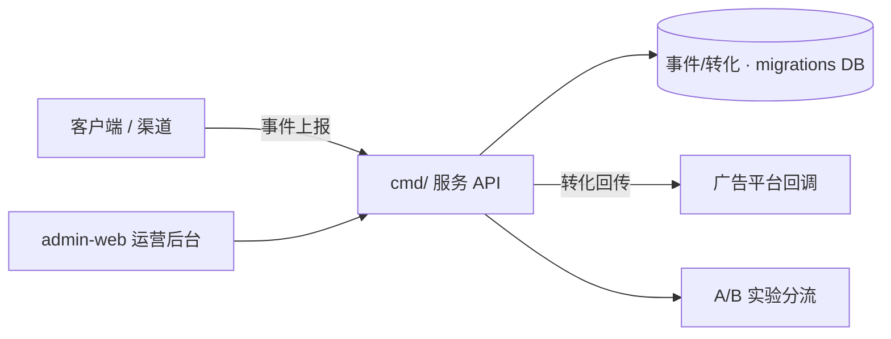

# meshy-growth-backend（Go 增长后台）

Go 实现的增长后台：**行为事件追踪、广告转化回传、A/B 实验分流**，并带一个**运营管理界面**（admin-web）。

## 功能
- 行为事件上报与入库
- 广告平台**转化回传**（conversion callback）
- **A/B 实验**分流与统计
- 运营后台（admin-web）管理

## 架构与流程


## 项目结构
```
meshy-growth-backend/
├─ cmd/            # 服务入口
├─ internal/       # 核心逻辑（API/事件/实验）
├─ admin-web/      # 运营管理前端
├─ migrations/     # 数据库迁移
├─ docs/           # 文档
├─ testdata/
├─ docker-compose.yml / Dockerfile / go.mod
└─ .env.example
```

## 快速开始
```
cp .env.example .env
docker-compose up --build         # 或用 go run ./cmd/...
# admin-web 见其目录 README / package.json
```

## 配置
参考 `.env.example`。

## 许可证
见仓库。