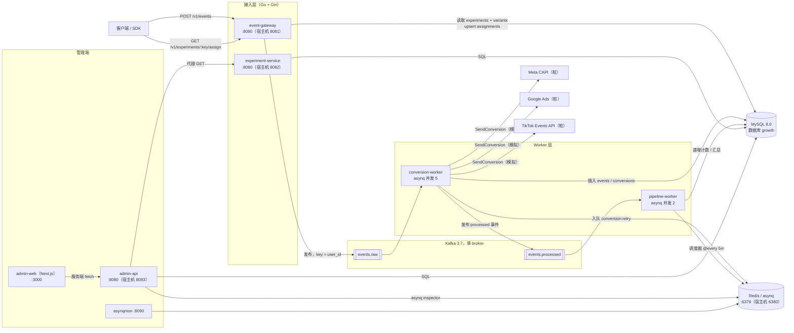
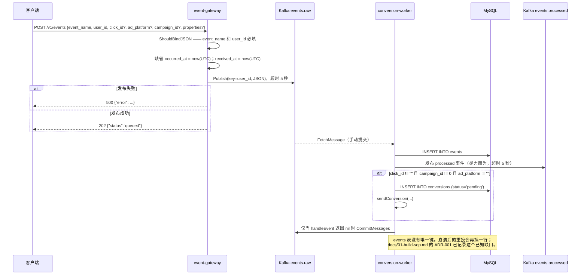
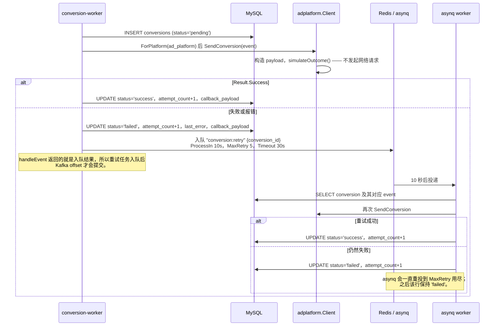
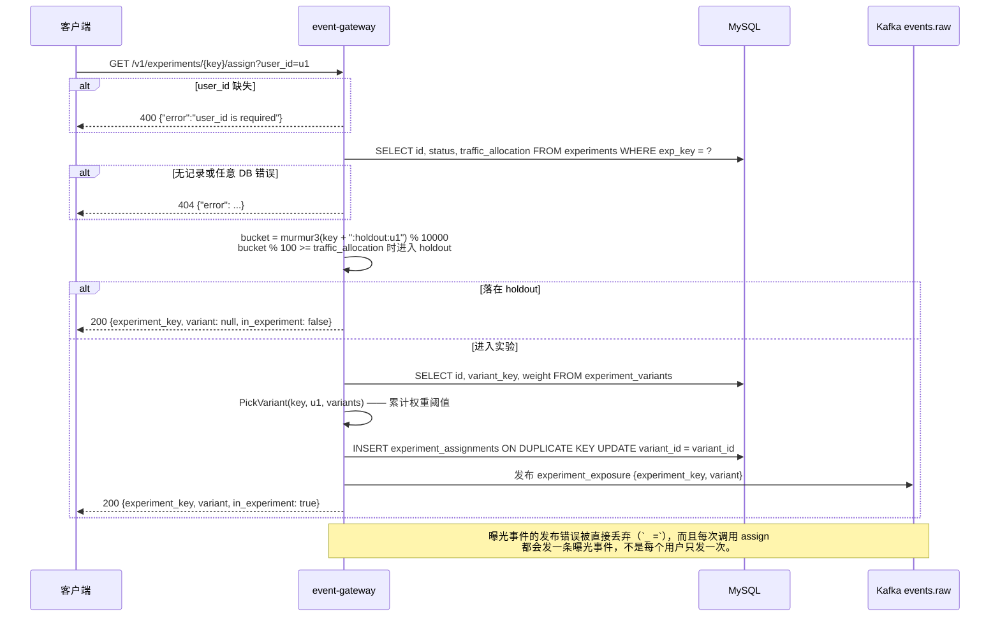
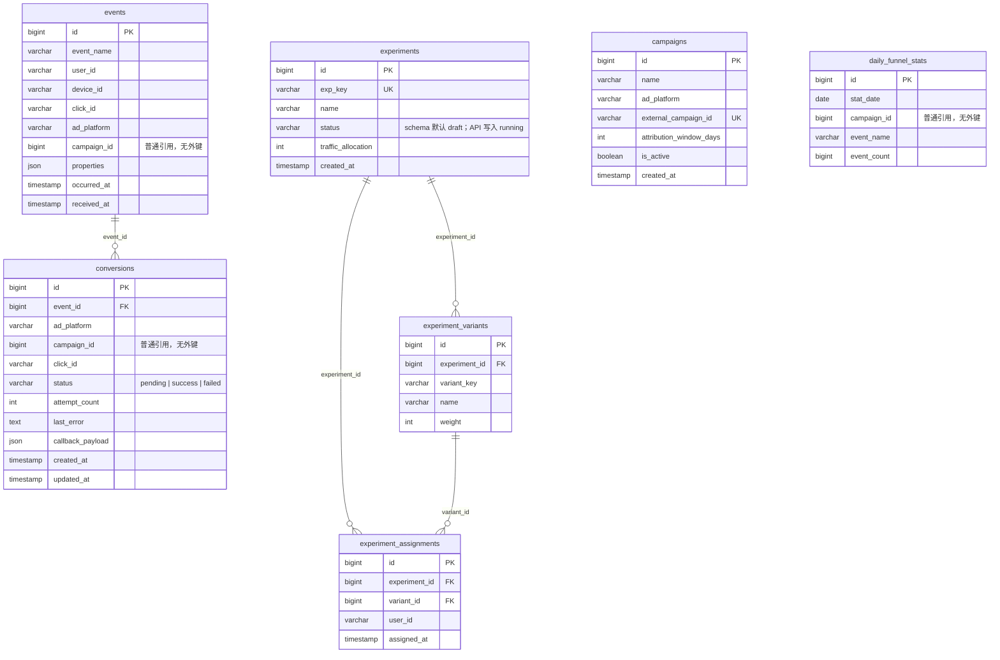
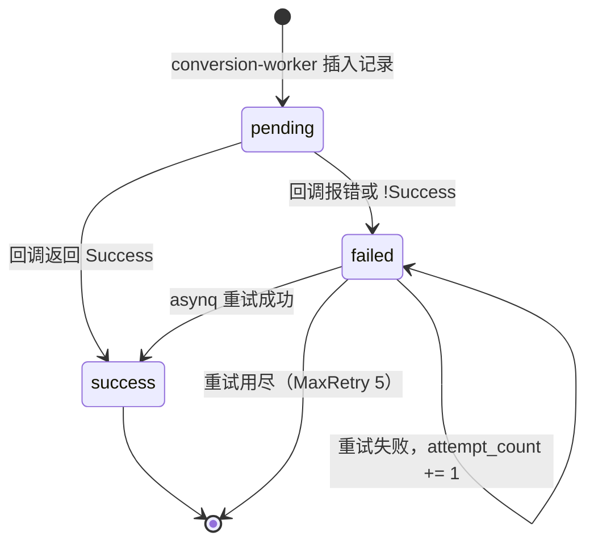

# meshy-growth-backend

[English](README.md) | [简体中文](README.zh-CN.md)

一个 Go 实现的增长基础设施原型：基于 Kafka 的事件接入、向 Meta / Google / TikTok 发起服务端转化回传、带 Wilson 区间和 SRM 检验的确定性 A/B 分桶，以及一个 Next.js 管理后台。六个 Go 服务共用一套 MySQL schema，一条 `docker compose up` 即可全部启动。

> **这是原型，不是生产系统。** 广告平台客户端会拼出真实的请求体，但从不真正发送（`internal/adplatform/client.go:46-55`）。没有任何接口带鉴权。`daily_funnel_stats` 由 `pipeline-worker` 写入，却没有任何 API 读取它。下面逐项说明。

---

## 概览

增长团队要回答三个问题：用户做了什么、一次转化能否归因到带来它的那条广告、产品改动有没有推动指标。本仓库把这三件事接进一套小系统：

| 问题 | 组件 | 存储 |
|---|---|---|
| 事件采集 | `event-gateway` → Kafka `events.raw` → `conversion-worker` | `events` |
| 转化归因 | `conversion-worker` + `internal/adplatform` + asynq 重试 | `conversions` |
| A/B 分流与读数 | `event-gateway`（分桶）+ `experiment-service`（统计） | `experiments*` |
| 每日漏斗计数 | `pipeline-worker` | `daily_funnel_stats` |
| 运营界面 | `admin-api` + `admin-web` | 读模型 |

它分别对应 Segment/RudderStack（数据管道）、Meta CAPI / Google Ads / TikTok Events API（转化上报）和 GrowthBook/Statsig（分流与统计）。行为是真的，对广告平台的出站调用是模拟的；目标读者是想找一个可运行、可观察示例的工程师——这里没有多租户模型。

---

## 目录

- [功能](#功能)
- [架构](#架构)
- [关键链路](#关键链路)
- [数据模型](#数据模型)
- [目录结构](#目录结构)
- [快速开始](#快速开始)
- [常用命令](#常用命令)
- [配置](#配置)
- [API](#api)
- [部署](#部署)
- [故障排查](#故障排查)
- [设计取舍与已知局限](#设计取舍与已知局限)
- [常见问题](#常见问题)
- [许可证](#许可证)

---

## 功能

**事件接入**
- `POST /v1/events` 要求提供 `event_name`/`user_id`，打上 `received_at`，以 `user_id` 为 key 发布到 Kafka 后返回
  `202 {"status":"queued"}`（`cmd/event-gateway/main.go:48-74,117`）；`occurred_at` 缺省取当前 UTC 时间（`:54-57`）。
- 只有 worker 的数据库写入成功后才会提交 offset（`cmd/conversion-worker/main.go:81-87`）。

**转化回传**
- 只有 `click_id`、`campaign_id`、`ad_platform` 三者俱全时才会创建转化记录（`cmd/conversion-worker/main.go:111-119`）。
- 平台构造器覆盖 Meta CAPI、Google Ads 点击转化上传（时间格式是 `yyyy-MM-dd HH:mm:ss+HH:MM`，不是 RFC3339）和 TikTok Events API（`internal/adplatform/*.go`）。
- 生成的请求体保存在 `conversions.callback_payload`；失败后通过 asynq 重试，延迟 10 秒、`MaxRetry(5)`、超时 30 秒（`cmd/conversion-worker/main.go:221-233`）。

**A/B 实验**
- 对 `experimentKey + ":" + userId` 做 murmur3 哈希，在 `[0, 10000)` 内取桶（`internal/experiment/experiment.go:9-12`），按权重累计阈值选变体（`:21-39`）。
- holdout 哈希使用单独的盐 `expKey + ":holdout"`，因此调整 `traffic_allocation` 不会重排已经在某个变体里的用户（`cmd/event-gateway/main.go:130`）。
- 分流记录对每个 `(experiment_id, user_id)` 只插入一次（`:159-162`）。
- 统计返回各变体计数、转化率、95% Wilson 区间、相对第一个变体的两比例 z 检验 p 值，以及卡方 SRM 检验，`p < 0.01` 时标记异常（`cmd/experiment-service/main.go:197-265`）。

**运营后台**
- 四个栏目——Events、Conversions、Experiments、Campaigns（`admin-web/components/NavBar.tsx:3-8`）——全部用 Next.js 服务端组件渲染；新建 campaign 是 server action（`admin-web/app/campaigns/page.tsx:7-27`），conversions 页展示状态计数、队列深度和最近 100 行（`admin-web/app/conversions/page.tsx:13-18`）。

**测试与验证**
- Go 单元测试覆盖分桶（`internal/experiment/experiment_test.go`）和统计函数，后者既对照手工核算值，也对照一份真实的 28.8 万行数据集（`cmd/experiment-service/stats_test.go`）；`testdata/` 另有一个离线聚合脚本和一个在线回放工具（CSV 已 gitignore）。

---

## 架构



| 层 | 路径 | 职责 |
|---|---|---|
| 接入 HTTP | `cmd/event-gateway` | `POST /v1/events`、`GET /v1/experiments/:key/assign`；发布到 Kafka，并直接读写实验相关表 |
| 转化 worker | `cmd/conversion-worker` | 消费 `events.raw`，写 `events` + `conversions`，调用广告客户端，入队重试，再发布到 `events.processed` |
| 管道 worker | `cmd/pipeline-worker` | 消费 `events.processed` 递增 `daily_funnel_stats`；每 5 分钟的调度器做一次对账 |
| 实验 HTTP | `cmd/experiment-service` | 实验创建 / 列表 / 详情、统计、Wilson 区间、p 值、SRM |
| 管理 HTTP | `cmd/admin-api` | 基于 MySQL 的读模型、新建 campaign、asynq 队列状态、代理到 experiment-service |
| 管理前端 | `admin-web/` | Next.js 15 服务端组件，四个页面加实验详情页 |
| 广告适配 | `internal/adplatform` | 同一 `Client` 接口下的各平台请求体构造器；`simulateOutcome` 替代真实 HTTP |
| 分桶 | `internal/experiment` | 纯函数 `Bucket` / `PickVariant` |
| 迁移 / 基础设施 | `cmd/migrate` + `migrations/`；`docker-compose.yml` | golang-migrate 执行 `0001_init` 的 `Up()`；MySQL 8.0、Redis 7、Kafka 3.7（KRaft）、asynqmon、seed |

宿主机端口来自 `docker-compose.yml:76,126,142,155,166,13,25,47`。在 compose 网络内部，每个 HTTP 服务都监听 `:8080`，只有宿主机端口不同。

与另一份文档的一处不一致：`docs/02-architecture.md:52` 把分桶画成 `event-gateway → experiment-service`，但网关是直接查 MySQL 的（`cmd/event-gateway/main.go:120-167`），从不调用 `experiment-service`。那张图的其余部分与代码一致。

---

## 关键链路

### 1. 事件接入，以及去重发生在哪里

接入链路**没有幂等键**：每一个被接受的 `POST /v1/events` 都会变成新的一行。去重被推迟到别处——分流记录按 `(experiment_id, user_id)` 唯一，统计用 `COUNT(DISTINCT user_id)`，广告平台则拿 `event_id` 作为匹配键。



如果 `handleEvent` 失败，循环只打日志并继续，**不提交**（`cmd/conversion-worker/main.go:81-84`）；此时 kafka-go 的进程内 reader 已经前进，所以只有重启后才会从最后提交的 offset 重放。

### 2. 转化回传与重试

`sendConversion` 从不发起 HTTP 请求：客户端只把请求体序列化，然后调用 `simulateOutcome`，后者有 15% 的概率失败（`internal/adplatform/client.go:50-55`）。每次尝试都会把 `attempt_count` 加一，并把本应发送的请求体写进 `callback_payload`。



`retryConversion` 会从 `events` 表重建事件，而不是信任任务 payload，因此任务里只需要带转化 id（`cmd/conversion-worker/main.go:172-206`）。

### 3. A/B 分流与曝光记录

分桶在网关里直接对 MySQL 完成。`traffic_allocation` 是整数百分比；holdout 哈希与变体哈希用了不同的盐，因此调整流量比例与用户归属互相独立。`TestBucketHoldoutSaltIsIndependent` 断言两者确实会分叉（`internal/experiment/experiment_test.go:18-36`）。



返回的变体每次都按当前权重重算，而持久化的分流记录只插入一次。因此修改变体权重后，接口响应和数据库里的记录可能对不上，直到实验被重建。

**后台路径：** 服务端组件异步调用 `fetchJSON`，并带 `cache: "no-store"`（`admin-web/lib/api.ts:1-11`）；`admin-api` 读取 MySQL，并把实验相关路由代理到 `experiment-service`，透传状态码和响应体（`cmd/admin-api/main.go:187-220`）。

---

## 数据模型

所有表都由 `migrations/0001_init.up.sql` 创建。外键只有下面这几条：`events`、`conversions`、`daily_funnel_stats` 对 `campaigns` 都**没有**外键约束。



索引服务于热点读取和 upsert：`events` 上有 `idx_events_click_id`、`idx_events_campaign`、`idx_events_user_name_time` 和 `idx_events_received_at`，`conversions` 上有 `idx_conversions_status` / `idx_conversions_campaign`，分流表上有 `uniq_experiment_user`，`daily_funnel_stats` 上有 `uniq_daily_stat`（`migrations/0001_init.up.sql:12-84`）。

### 转化状态机



`pending` 只存在于插入和第一次同步发送之间，两步都在 `handleEvent` 里（`cmd/conversion-worker/main.go:116-131`）；没有任何轮询会碰它。

### 实验状态

`experiments.status` 没有生命周期：schema 默认值是 `draft`（`migrations/0001_init.up.sql:50`），`POST /v1/experiments` 插入的是 `running`（`cmd/experiment-service/main.go:96`），没有任何接口更新它，`assignVariant` 也只是把这一列查出来而不做判断（`cmd/event-gateway/main.go:124-128`）。所以无论状态是什么，每一行实验都会正常对外分流。

---

## 目录结构

```text
meshy-growth-backend/
├─ cmd/
│  ├─ event-gateway/        # POST /v1/events、GET /v1/experiments/:key/assign
│  ├─ conversion-worker/    # Kafka 消费者、写库、广告回调、重试
│  ├─ pipeline-worker/      # 漏斗计数 + 每 5 分钟对账
│  ├─ experiment-service/   # 实验 CRUD + 统计（stats.go、stats_test.go）
│  ├─ admin-api/            # 管理端读模型、新建 campaign、代理
│  ├─ migrate/              # golang-migrate Up()
│  └─ seed/                 # 演示 campaign、实验、200 个模拟用户
├─ internal/
│  ├─ adplatform/           # Client 接口 + meta/google/tiktok 构造器 + 桩结果
│  ├─ config/ · db/         # 环境变量默认值；MySQL 带重试连接 + 迁移封装
│  ├─ experiment/           # murmur3 Bucket + PickVariant（含测试）
│  ├─ httpserver/ · kafka/  # gin SIGTERM 优雅退出（15 秒）；kafka-go 生产/消费
│  └─ models/ · queue/      # 行结构体；asynq client/server/scheduler + 任务类型
├─ migrations/              # 0001_init 上下迁移，7 张表
├─ admin-web/               # Next.js 15 App Router 后台（Tailwind、vitest）
│  ├─ app/                  # /、/events、/conversions、/campaigns、/experiments、/experiments/[key]
│  ├─ components/ · lib/    # NavBar、RefreshButton（含测试）；fetchJSON + 类型
│  └─ Dockerfile            # standalone 产物 → node server.js
├─ docs/ · testdata/        # 9 篇编号中文文档 + 索引；Udacity A/B 工具（CSV 已 gitignore）
├─ Dockerfile · docker-compose.yml
├─ .env.example · go.mod
```

---

## 快速开始

### 方式 A —— Docker Compose

需要 Docker Desktop 和 Compose v2，本地不需要 Go 或 Node。

```bash
git clone https://github.com/Ethan-upgrade/meshy-growth-backend.git
cd meshy-growth-backend
docker compose build
docker compose up -d
docker compose ps                    # mysql/redis/kafka 应显示 "healthy"
curl -s http://localhost:8081/healthz http://localhost:8082/healthz http://localhost:8083/healthz

docker compose run --rm seed         # 200 个用户、3 个 campaign、1 个实验
# 打开 http://localhost:3000         # admin-web 会跳转到 /events
```

`migrate` 是一次性服务：等 MySQL 健康检查通过，执行 `0001_init`，退出码 0，业务服务则以 `service_completed_successfully` 为依赖条件（`docker-compose.yml:54-64,77-79`）。`seed` 挂在 `seed` profile 下，所以直接 `up` 不会执行它。

```bash
curl -X POST http://localhost:8081/v1/events \
  -H "Content-Type: application/json" \
  -d '{"event_name":"purchase","user_id":"tutorial-user-1","click_id":"demo-click-1",
       "ad_platform":"meta","campaign_id":1,"properties":{"value":199}}'
# {"status":"queued"}
```

### 方式 B —— 直接运行单个服务

需要 Go 1.25，以及可连通的 MySQL/Redis/Kafka（compose 栈即可，宿主机端口分别是 3306、6380、9092）。配置里的默认值指向 compose 主机名，所以要显式覆盖：

```bash
export MYSQL_DSN='app:app@tcp(127.0.0.1:3306)/growth?parseTime=true&multiStatements=true'
export REDIS_ADDR='127.0.0.1:6380'
export KAFKA_BROKERS='127.0.0.1:9092'
MIGRATIONS_PATH=./migrations go run ./cmd/migrate
HTTP_ADDR=:8080 go run ./cmd/event-gateway
```

镜像会把 `migrations/` 复制到 `/app/migrations`，所以 `MIGRATIONS_PATH` 默认指向那里；本地运行必须显式设置。

### 在 Docker 之外运行 admin-web

```bash
cd admin-web
npm install
ADMIN_API_URL=http://localhost:8083 npm run dev   # http://localhost:3000
```

`ADMIN_API_URL` 在请求时由服务端读取（`admin-web/lib/api.ts:1`），不会下发到浏览器。

### 构建

```bash
go build ./cmd/...                    # 全部七个 Go 二进制
docker compose build                  # 每个服务一个 distroless 镜像
cd admin-web && npm run build         # standalone 模式的 Next 构建
```

本仓库**没有任何 CI 配置**（没有 `.github/`，也没有流水线文件），所以以上步骤都不会自动执行。

---

## 常用命令

| 命令 | 作用 |
|---|---|
| `docker compose build` | 构建镜像；每个镜像用 `ARG SERVICE` 选择 `./cmd/<service>` |
| `docker compose up -d` | 启动基础设施、migrate、gateway、两个 worker、experiment-service、admin-api、asynqmon、admin-web |
| `docker compose ps` / `logs -f <svc>` | 查看状态；跟踪日志 |
| `docker compose run --rm seed` | 写入 3 个 campaign、`checkout_button_color` 实验、200 个用户 |
| `docker compose restart <svc>` | 滚动重启；日志会出现 `shutting down gracefully` |
| `docker compose down -v` | 停止全部服务并删除 `mysql-data` 卷 |
| `go test ./...` | 运行 `internal/experiment` 和 `cmd/experiment-service` 的单元测试 |
| `go run ./cmd/{migrate,event-gateway,conversion-worker,pipeline-worker,experiment-service,admin-api,seed}` | 本地运行单个服务 |
| `cd testdata && go run compute_stats.go` | 离线聚合 `ab_data.csv` |
| `cd testdata && go run replay_ab_dataset.go -sample 3000` | 在线回放，然后对比统计结果 |
| `cd admin-web && npm run dev` / `build` | Next 开发模式 / 生产构建 |
| `cd admin-web && npm run lint` / `type-check` / `test` | ESLint、`tsc --noEmit`、vitest |

---

## 配置

每个 Go 配置项都是 `os.Getenv` 读取的环境变量，并带硬编码默认值（`internal/config/config.go:17-33`；`cmd/seed/main.go:26-27` 另外读取自己的两个 URL 变量）。这里**没有 `.env` 加载器**——`cp .env.example .env` 不会生效。`docker-compose.yml` 直接内联写入这些值。

| 变量 | 默认值 | 使用方 | 含义 |
|---|---|---|---|
| `HTTP_ADDR` | `:8080` | event-gateway、experiment-service、admin-api | 容器内监听地址 |
| `MYSQL_DSN` | `app:app@tcp(mysql:3306)/growth?parseTime=true&multiStatements=true` | 所有连库服务 | go-sql-driver DSN |
| `REDIS_ADDR` | `redis:6379` | conversion-worker、pipeline-worker、admin-api | asynq 与 inspector 后端地址 |
| `KAFKA_BROKERS` | `kafka:9092` | gateway、两个 worker | 逗号分隔的 broker 列表 |
| `MIGRATIONS_PATH` | `/app/migrations` | migrate | `file://` 迁移源目录 |
| `EXPERIMENT_SERVICE_URL` | `http://experiment-service:8080` | admin-api、seed | 代理前缀 |
| `ADMIN_API_URL` | `http://admin-api:8080` | admin-web | 服务端 base URL（`admin-web/lib/api.ts:1`） |
| `EVENT_GATEWAY_URL` | `http://event-gateway:8080` | seed | seeder 的投递目标（`cmd/seed/main.go:26`） |

`.env.example` 里还列了 `META_ACCESS_TOKEN`、`META_PIXEL_ID`、`GOOGLE_ADS_DEVELOPER_TOKEN`、`GOOGLE_ADS_CUSTOMER_ID`、`TIKTOK_ACCESS_TOKEN` 和 `TIKTOK_PIXEL_CODE`——全部被注释掉，而且**目前没有任何代码读取它们**。

Compose 宿主机端口：MySQL `3306`、Redis `6380`（容器内 `6379`）、Kafka `9092`、admin-web `3000`、asynqmon `8090`（`docker-compose.yml:13,25,47,166,155`）。

---

## API

### event-gateway（宿主机 `:8081`）

| 方法 | 路径 | 请求 | 响应 | 说明 |
|---|---|---|---|---|
| GET | `/healthz` | — | `text/plain` `ok` | 存活检查 |
| POST | `/v1/events` | `event_name`*、`user_id`*、`device_id`、`click_id`、`ad_platform`、`campaign_id`、`properties`、`occurred_at`（RFC3339） | `202 {"status":"queued"}` | 校验失败返回 `400`，Kafka 发布失败返回 `500`（`cmd/event-gateway/main.go:21-30,48-74`） |
| GET | `/v1/experiments/:key/assign?user_id=` | 必填 `user_id` | `{"experiment_key","variant","in_experiment"}` | 落在 holdout 时返回 `variant: null, in_experiment: false`。所有查询 / 数据库错误都映射为 `404`，包括实验不存在或没有变体（`:76-101`） |

只有 `click_id` 存在、`campaign_id != 0` 且 `ad_platform` 非空这三者同时成立，才会触发转化；只有 `event_name` + `user_id` 的事件是合法的，但永远不会产生转化（`cmd/conversion-worker/main.go:111-114`）。

### experiment-service（宿主机 `:8082`）

| 方法 | 路径 | 请求 | 响应 | 说明 |
|---|---|---|---|---|
| GET | `/healthz` | — | `ok` | |
| POST | `/v1/experiments` | `key`*、`name`*、`traffic_allocation`、`variants`*（至少 2 个，含 `key`、`name`、`weight`） | `201 {"id","key"}` | `traffic_allocation: 0` 会被当成 `100`，因此无法表达 0% 灰度（`cmd/experiment-service/main.go:45-47`）。key 重复返回 `500`，不是 `409` |
| GET | `/v1/experiments` | — | `[{"id","key","name","status","traffic_allocation"}]` | 按 `created_at DESC` 排序 |
| GET | `/v1/experiments/:key` | — | 概要 + `variants[]` | 任何错误都返回 `404` |
| GET | `/v1/experiments/:key/stats?goal_event=purchase` | `goal_event` 默认 `purchase` | `{"variants":[...],"srm_check":{...}}` | 按变体 id 排序；第一个是对照组 |

每条统计记录包含 `variant_key`、`assigned`、`converted`、`conversion_rate`、`confidence_interval`（Wilson，z = 1.96）和 `p_value_vs_control`（对照组不带该字段）。`srm_check` 的结构是 `{chi_square, p_value, flagged}`，`p < 0.01` 时置 `flagged`（`cmd/experiment-service/main.go:177-195,245-263`）。

聚合按 `user_id` 关联事件，并要求 `events.occurred_at >= assignments.assigned_at`（`:202-211`）。它没有把事件限定在本实验范围内，因此被分流用户在此之后的**任意**目标事件都会被计入。

### admin-api（宿主机 `:8083`）

| 方法 | 路径 | 请求 | 响应 | 说明 |
|---|---|---|---|---|
| GET | `/healthz` | — | `ok` | |
| GET | `/v1/events/recent` | — | 事件行 | 按 `received_at` 取最近 100 条 |
| GET | `/v1/conversions/summary` | — | `{"success":N,"failed":N,...}` | `GROUP BY status`；不存在的状态不会出现 |
| GET | `/v1/conversions/recent` | — | 转化行 | 按 `updated_at` 取最近 100 条 |
| GET | `/v1/queue/status` | — | `{pending,active,scheduled,retry,archived,completed,processed,failed}` | asynq 的 `default` 队列，两个 worker 共用 |
| GET | `/v1/campaigns` | — | `Campaign[]` | 按 `id DESC` 排序 |
| POST | `/v1/campaigns` | `name`*、`ad_platform`*、`external_campaign_id`*、`attribution_window_days`、`is_active` | `201 {"id"}` | 窗口缺省为 7；`is_active` 缺省为 `false`，会覆盖 schema 里的 `TRUE` 默认值（`cmd/admin-api/main.go:161-185`） |
| GET | `/v1/experiments`、`/v1/experiments/:key`、`/v1/experiments/:key/stats` | 透传 `goal_event` | 代理返回 | 上游状态码和响应体原样透传；查询参数拼接时未做 URL 编码 |

### admin-web 页面

`admin-web` 在服务端调用这些接口；`/` 会重定向到 `/events`，实验详情页把 `goal_event` 固定为 `purchase`。

---

## 部署

仓库只提供单机 Compose 部署，没有其他部署方式。

- 一个多阶段 `Dockerfile` 通过 `ARG SERVICE` 从 `golang:1.25-bookworm` 构建任意 Go 服务，运行阶段使用 `gcr.io/distroless/base-debian12`，并把 `migrations/` 复制到 `/app/migrations`（`Dockerfile:1-17`）。
- `admin-web` 以 standalone 模式构建，在 Node 22 上运行 `.next/standalone/server.js`（`admin-web/Dockerfile:1-22`）。
- 每个服务都是单副本：没有入口网关、负载均衡、镜像仓库、Kubernetes manifest 或监控栈。`asynqmon` 是第三方镜像 `hibiken/asynqmon:latest`，跑在 `8090`。
- 回滚方式是“切回较早的 commit 再重新构建”，没有版本化镜像（`docs/07-release-ops.md:98-119`）。Go 容器是 distroless，所以 `docker compose exec <service> sh` 只对 mysql/redis/kafka 可用。

---

## 故障排查

| 现象 | 原因 | 处理 |
|---|---|---|
| `mysql connect failed after retries` | MySQL 未就绪或 DSN 不对；`Connect` 会重试 30 次、每次间隔 2 秒（`internal/db/db.go:17-34`） | 检查 `docker compose ps mysql`，再核对 `MYSQL_DSN` |
| `migrate` 以非零码退出 | SQL 冲突、本地运行时没设 `MIGRATIONS_PATH`，或者某个服务因为 `depends_on` 要求 migrate 成功而退出 | 看 `docker compose logs migrate`；设置 `MIGRATIONS_PATH=./migrations` |
| 事件返回已接收，但界面上没有 | worker 在返回 202 之后处理失败，或者你在消费完成前就查了 | 看 `docker compose logs conversion-worker`；检查消费延迟 |
| 已存在的 key 调 `assign` 仍返回 404 | 所有数据库错误都映射成 404，包括“没有变体” | 查该实验在 `experiment_variants` 里的记录 |
| 约 15% 的转化是 `failed` | `simulateOutcome` 故意有 15% 的失败率（`internal/adplatform/client.go:50-55`） | 属于预期；只排查错误信息不是 `simulated transient error from ad platform` 的记录 |
| 某条转化一直是 `failed` | asynq 的 `MaxRetry(5)` 已用尽 | 到 http://localhost:8090 查看或重新入队 |
| `/v1/queue/status` 里 `retry` 一直不下降 | Redis 连不上，或任务持续失败 | `docker compose exec redis redis-cli ping`；检查 `REDIS_ADDR` |
| admin-web 返回 500 | `fetchJSON` 对任何非 2xx 都抛错（`admin-web/lib/api.ts:8-10`），通常是上游挂了 | 先 `curl localhost:8083/v1/experiments`，再 `curl localhost:8082/healthz` |
| `POST /v1/campaigns` 返回 500 | `external_campaign_id` 已存在（唯一键冲突） | 换一个唯一的外部 id |
| 宿主机端口被占用 | 3306/6380/9092/3000/8081-8083/8090 已被使用 | 修改端口映射的宿主机一侧 |
| `up` 之后没有演示数据 | `seed` 在 profile 后面 | `docker compose run --rm seed` |
| 本地服务解析不了 `mysql:3306` | compose 主机名在宿主机上不可解析 | 改用 `127.0.0.1:3306`、`:6380`、`:9092` |

---

## 设计取舍与已知局限

**有意的选择**

- **广告调用是模拟的。** `SendConversion` 只序列化 payload；`simulateOutcome` 返回成功或一个合成出来的瞬时失败（`internal/adplatform/client.go:33-55`）。请求体形状遵循公开文档，但从不真正发出。
- **事件流用 Kafka，重试和定时任务用 asynq；offset 手动提交。** 两个消费组需要同一批事件，而重试 / 定时语义更适合任务队列（`docs/02-architecture.md:75-86`）；`FetchMessage` + `CommitMessages` 用重复换取更少的丢失（`docs/01-build-sop.md:100-108`）。
- **分桶放在网关，统计放在 experiment-service。** 分流只需一次数据库读取加一个确定性纯函数，客户端可缓存；聚合逻辑则留在统计服务里。

**已知缺口**

| 缺口 | 位置 |
|---|---|
| 事件级没有幂等；重投可能重复插入 events 和 conversions | `cmd/conversion-worker/main.go:94-133`；`docs/01-build-sop.md` 的 ADR-001 |
| 进程内 handler 失败后，Kafka 消息要等到重启才会重放 | `cmd/conversion-worker/main.go:81-84` |
| 所有服务都没有鉴权、授权、限流、TLS 或 CORS 中间件 | 全部 `cmd/*/main.go` |
| `experiments.status` 会被读取但不生效；draft/paused 的实验照样分流 | `cmd/event-gateway/main.go:124-128` |
| 分流记录只插入一次，而响应每次重算，改权重会让两者不一致 | `cmd/event-gateway/main.go:159-162` |
| 每次调用 assign 都会发布曝光事件；发布错误被忽略 | `cmd/event-gateway/main.go:93-100` |
| `attribution_window_days` 和 `external_campaign_id` 仅存储 / 展示，转化逻辑不用 | `cmd/admin-api/main.go:134-185`；`cmd/conversion-worker` 中无引用 |
| 转化资格判断忽略归因窗口和 campaign 的启用标记 | `cmd/conversion-worker/main.go:111-114` |
| 统计把被分流用户此后的任意目标事件都算进去，而不是实验范围内的曝光 | `cmd/experiment-service/main.go:202-211` |
| 管理后台把 `goal_event` 写死为 `purchase` | `admin-web/app/experiments/[key]/page.tsx:13` |
| `traffic_allocation: 0` 无法配置（会被当作 100） | `cmd/experiment-service/main.go:45-47` |
| admin-api 用字符串拼接构造上游 URL，key 和 `goal_event` 都没做 URL 编码 | `cmd/admin-api/main.go:188-197` |
| 没有 CI，构建里没有集成测试，也没有指标 / 链路追踪 / 告警 | 仓库根目录 |
| 文档与代码对“网关是否调用 experiment-service”说法不一 | `docs/02-architecture.md:52` vs `cmd/event-gateway/main.go:120-167` |

**关于 SQL 注入。** 所有 SQL 都是带 `?` 占位符的常量字符串，参数走绑定（`cmd/admin-api/main.go:35-36`、`cmd/event-gateway/main.go:125,160`、`cmd/experiment-service/main.go:202-211`、`cmd/conversion-worker/main.go:97-99`）。没有任何用户输入被拼进 SQL，因此这些查询不存在注入面。唯一一处字符串拼接是上面提到的上游代理 URL，属于代理问题而非 SQL 问题。

---

## 常见问题

**转化真的会送到 Meta/Google/TikTok 吗？**
不会。客户端构造出符合文档的 JSON，存进 `callback_payload`，再由 `simulateOutcome` 在本地决定成功与否。要真正上线，需要替换每个 `SendConversion` 的函数体并提供凭据。

**为什么大约 15% 的转化记录是 failed？**
这是桩代码故意设置的失败率，用来跑通 asynq 重试链路。用 `last_error NOT LIKE '%simulated%'` 过滤后看到的才是真实失败。

**同一个用户下次会分到不同变体吗？**
只要 key、user id 和权重不变就不会：分桶是 `murmur3(key + ":" + userID)`，分流记录按 `(experiment_id, user_id)` 唯一。修改权重或重建实验可能改变计算结果。只改 `traffic_allocation` 不会，因为 holdout 判断单独对 `key + ":holdout"` 做哈希。

**能在管理后台创建实验吗？**
不能。`admin-web` 只负责列出实验和展示统计；创建要调 `experiment-service` 的 `POST /v1/experiments`。Campaign 倒是有创建表单。

**怎么修改转化目标事件？**
调用 `experiment-service` 或 `admin-api` 的 `/v1/experiments/:key/stats?goal_event=<name>`。管理后台的详情页始终传 `purchase`。暂停功能没有实现：没有更新接口，`assignVariant` 也不看 `status`。

**可以不用 Docker 跑吗？**
可以，需要 Go 1.25 和可连通的 MySQL/Redis/Kafka，但必须覆盖 `MYSQL_DSN`、`REDIS_ADDR`、`KAFKA_BROKERS` 和 `MIGRATIONS_PATH`；默认值用的是 compose 主机名和 `/app/migrations`。

---

## 许可证

本仓库没有包含许可证文件。除非作者另有说明，否则视为保留所有权利。
