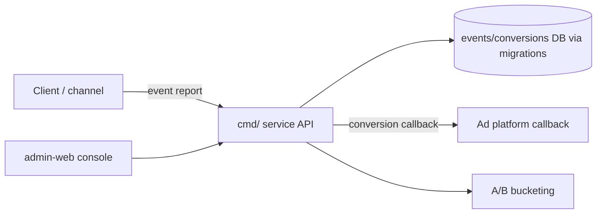

# meshy-growth-backend (Go growth backend)

A Go growth backend: **behavioral event tracking, ad-conversion callbacks, A/B experiment bucketing**, plus an **operations admin UI** (admin-web).

## Features
- Behavioral event ingestion and persistence
- Ad-platform **conversion callbacks**
- **A/B experiments** bucketing and stats
- Operations admin (admin-web)

## Architecture & Workflow


## Project Structure
```
meshy-growth-backend/
├─ cmd/            # service entry
├─ internal/       # core logic (API/events/experiments)
├─ admin-web/      # admin frontend
├─ migrations/     # DB migrations
├─ docs/
├─ testdata/
├─ docker-compose.yml / Dockerfile / go.mod
└─ .env.example
```

## Getting Started
```
cp .env.example .env
docker-compose up --build         # or: go run ./cmd/...
# see admin-web/ for the admin console
```

## Configuration
See `.env.example`.

## License
See the repository.