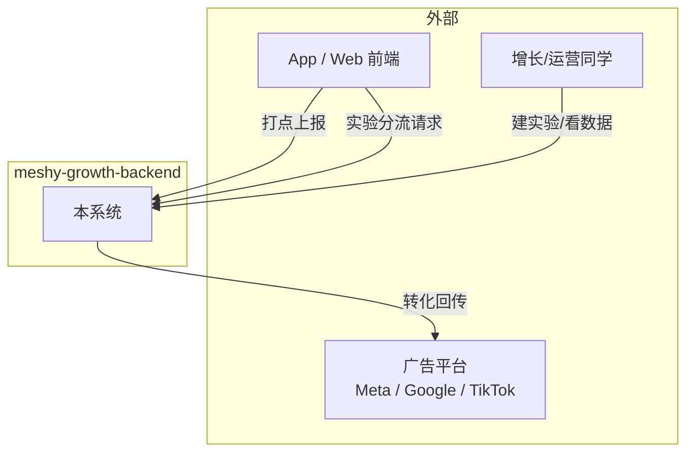

# 00. 产品概览与术语表

## 1. 这个系统解决什么问题

增长团队投放广告后，天然要回答三个问题：

1. **用户在 App/网页里做了什么？**（打点 / 事件采集）
2. **这个转化能不能记到投放渠道头上，好让广告平台优化投放？**（转化回传 / Conversion API）
3. **改了个按钮颜色，到底有没有用？**（A/B 实验）

`meshy-growth-backend` 就是把这三件事用一套自建后台串起来的原型系统，对标业界的 **Segment/RudderStack**（事件管道）+ **Meta CAPI / Google Enhanced Conversions / TikTok Events API**（转化回传）+ **GrowthBook / Statsig**（实验平台）。

## 2. 产品定位

| 维度 | 说明 |
|---|---|
| 产品形态 | 内部增长基础设施（Growth Infra），非面向最终 C 端用户 |
| 核心用户 | 增长/买量同学（配实验、看转化）、研发（接入打点）、数据分析（拉数） |
| 不做的事 | 不做用户画像/CDP 全量身份合并，不做多方数据安全屋，不做可视化 BI（复杂报表交给下游 BI 工具） |
| 对标产品 | Segment、RudderStack（事件管道）；GrowthBook、Statsig、Unleash（实验平台）|

## 3. 核心名词表

| 术语 | 英文 | 定义 |
|---|---|---|
| 事件 | Event | 用户在产品里产生的一次行为，如 `page_view`、`purchase` |
| 点击 ID | Click ID | 广告平台在用户点击广告跳转落地页时带上的追踪参数（如 Google 的 `gclid`、TikTok 的 `ttclid`），是转化回传"对得上账"的关键 |
| 转化回传 | Conversion Upload / CAPI | 把服务端确认的转化事件，通过服务器对服务器（S2S）接口回传给广告平台，弥补浏览器端像素因隐私保护丢失的数据 |
| 归因窗口 | Attribution Window | 从点击广告到发生转化，仍计入该广告效果的最长时间窗口（如 7 天） |
| 实验 / 分桶 | Experiment / Bucketing | 把用户按确定性哈希分配到不同实验组（variant），保证同一用户每次访问结果一致 |
| 灰度比例 | Traffic Allocation | 只有这个百分比的用户会进入实验，其余留在 holdout（对照参照组之外，完全不受影响） |
| 样本比例失衡 | SRM, Sample Ratio Mismatch | 实际分桶比例明显偏离配置比例，通常意味着分桶或统计逻辑有 bug，是实验可信度的第一道红线检查 |
| 死信/重试 | DLQ / Retry | 处理失败的任务被重新排队重试，而不是直接丢弃 |

## 4. 系统边界（Context Diagram）

后续文档均围绕这张边界图展开：文档 02 打开"本系统"内部；文档 03/04/05 讲怎么对接"外部"三方。
