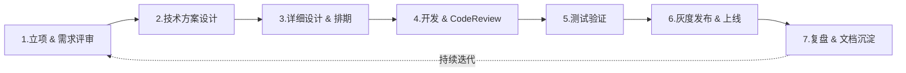
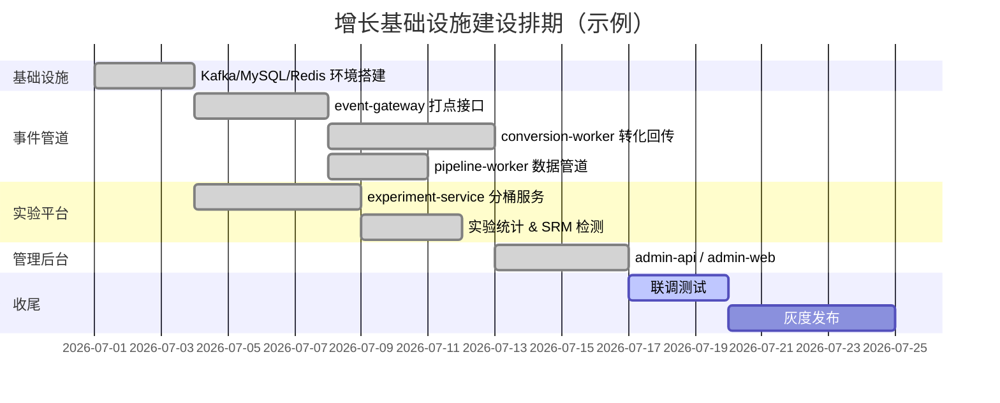
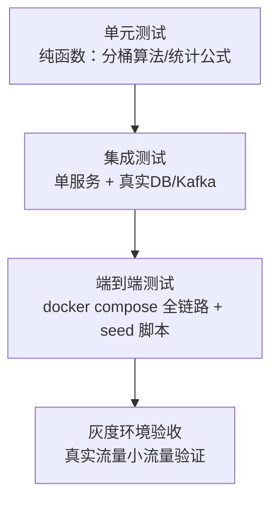
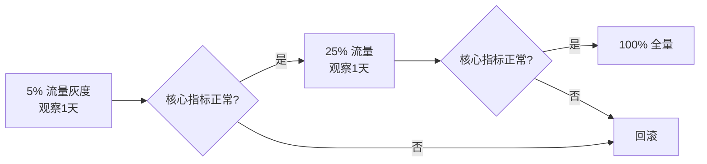

# 01. 系统建设 SOP（从 0 到 1 标准流程）

> 本篇是给 **PM/研发 Leader** 看的，如果你要复刻一套类似的增长基础设施，照着这个流程走一遍，能少踩很多"做完了才发现需求理解错了"的坑。这是大厂中台/基础设施类项目的通用 SOP，共 7 个阶段。

## 全流程总览



| 阶段 | 典型耗时（中厂参考） | 负责人 | 关键产出 |
|---|---|---|---|
| 1. 立项与需求评审 | 3-5 个工作日 | PM | PRD、优先级排序、干系人对齐记录 |
| 2. 技术方案设计 | 3-5 个工作日 | 技术负责人/架构 | 技术方案文档（RFC）、评审会议纪要 |
| 3. 详细设计与排期 | 2-3 个工作日 | 研发 | 接口契约、数据模型、任务拆解、里程碑甘特图 |
| 4. 开发与 Code Review | 视规模，本项目约 2-3 周 | 研发 | 代码、单测、CR 记录 |
| 5. 测试验证 | 与开发并行 + 收尾 3-5 天 | QA/研发自测 | 测试用例、缺陷清单、验收报告 |
| 6. 灰度发布与上线 | 1-2 周灰度期 | 研发/SRE | 发布计划、灰度指标看板、Runbook |
| 7. 复盘与文档沉淀 | 上线后 1 周内 | PM 主持 | 复盘纪要、文档归档、后续 Roadmap |

---

## 阶段 1：立项与需求评审

### 1.1 需求来源与优先级判断

大厂常用 **RICE 模型**（Reach 影响人数 / Impact 影响程度 / Confidence 把握度 / Effort 投入成本）给需求打分排优先级。本项目的立项背景示例：

| 需求 | Reach | Impact | Confidence | Effort | RICE 分 |
|---|---|---|---|---|---|
| 事件采集 + Kafka 管道 | 高（全公司打点依赖） | 高 | 高 | 中 | 高优先，P0 |
| 广告转化回传（Meta/Google/TikTok） | 中（投放团队） | 高（直接影响 ROI） | 高 | 中 | P0 |
| A/B 实验平台 | 中（增长团队） | 高（决策质量） | 中 | 高 | P1 |
| 数据管道日报表（daily_funnel_stats） | 低 | 中 | 高 | 低 | P1 |

### 1.2 PRD 核心章节（模板）

```markdown
# PRD: 增长事件与实验基础设施

## 背景与问题
现状：打点散落各业务方自建、转化回传靠人工配置像素、实验全靠前端 hardcode 分支——
数据口径不一致，广告优化效果差，实验结果不可信。

## 目标（Goals）
1. 统一事件采集入口，P99 延迟 < 200ms
2. 转化事件 T+0 内回传三大广告平台，成功率 > 95%（含重试）
3. 实验分桶误差 < 1%，具备 SRM 自动检测能力

## 非目标（Non-goals）
- 不做用户身份跨设备合并（留给后续 CDP 项目）
- 不做自定义 BI 报表（对接现有数据仓库/BI 工具）

## 用户故事
- 作为投放同学，我希望转化数据自动回传到 Google Ads，这样广告能自动优化出价
- 作为增长同学，我希望创建一个实验并设置 50% 灰度，观察 A/B 两组转化率差异
- 作为研发，我希望一个 SDK 调用就能上报事件，不用关心底层存哪张表

## 验收标准（Acceptance Criteria）
见"阶段 5 测试验证"的验收清单
```

### 1.3 干系人对齐（RACI）

| 活动 | PM | 研发TL | 后端 | 前端 | 投放/增长 | SRE |
|---|---|---|---|---|---|---|
| PRD 撰写 | R/A | C | C | C | C | I |
| 技术方案评审 | I | R/A | R | C | I | C |
| 开发排期 | C | R/A | R | R | I | I |
| 上线决策 | A | R | C | C | I | R |

*R=负责执行，A=最终拍板，C=需要咨询，I=需要知会*

**产出物**：PRD 文档 + 需求评审会议纪要（含遗留问题 Action Item 列表）。

---

## 阶段 2：技术方案设计（RFC）

### 2.1 技术选型对比表（示例：事件管道选型）

| 方案 | 优点 | 缺点 | 结论 |
|---|---|---|---|
| 直接写 MySQL，同步返回 | 简单，一致性强 | 打点接口和写库耦合，QPS 上不去，单点故障影响全部业务 | ❌ |
| Kafka 异步解耦 | 削峰填谷，下游多消费者独立扩展，重放能力 | 引入运维复杂度，需要处理 offset 提交时机 | ✅ 采用 |
| 直接调云厂商 CDP SaaS | 免运维 | 数据出境/成本/定制化受限 | 后续可评估，本期先自建 |

### 2.2 关键设计决策记录（ADR, Architecture Decision Record）

大厂做技术方案评审时，重大决策要留 ADR，方便日后追溯"当时为什么这么做"：

```markdown
## ADR-001: Kafka 消费者必须先处理后提交 offset

**背景**：kafka-go 的 Reader.ReadMessage 默认在返回消息前自动提交 offset。
**问题**：如果消费者在处理消息过程中崩溃/被 SIGKILL，这条消息已被标记为"已消费"，
        永久丢失，不会被重新投递——违反了"转化数据不能丢"的核心目标。
**决策**：改用 FetchMessage（不自动提交）+ 业务处理成功后显式 CommitMessages。
**代价**：可能出现"至少一次"语义下的重复处理（消息处理成功但提交前崩溃），
        需要下游具备幂等能力（本期已知缺口，记录为后续待办）。
**状态**：已采纳
```

> 本项目在实际迭代中就采用过这种 ADR 记录方式来管理架构决策，参见 [02 架构设计](02-architecture.md) 中的 A/D 项。

### 2.3 技术方案评审 Checklist

评审会议前，方案文档必须覆盖以下问题，评审人逐项打勾：

- [ ] 数据模型（表结构/索引）是否支持核心查询场景，有没有做容量预估？
- [ ] 服务拆分边界是否清晰？谁拥有哪张表的写权限？
- [ ] 失败/重试/幂等策略是什么？消息会不会丢、会不会重复？
- [ ] 优雅启停：进程收到 SIGTERM 时，正在处理的请求/消息怎么办？
- [ ] 是否有单点故障？限流/降级方案是什么？
- [ ] 安全边界：谁能调用这些接口？敏感数据（PII）怎么处理？
- [ ] 可观测性：出问题了怎么第一时间发现（日志/指标/告警）？

**产出物**：技术方案文档（含架构图、ADR 列表）+ 评审纪要。

---

## 阶段 3：详细设计与排期

### 3.1 接口契约先行（Contract-First）

前后端/上下游团队并行开发的前提是先锁定接口契约。本项目的契约放在 [04 API 使用手册](04-api-guide.md)，评审通过后才允许各方并行开发。

### 3.2 任务拆解与里程碑（甘特图示例）



### 3.3 服务拆分与代码归属

| 服务 | 目录 | 负责模块 | 数据库表读写权限 |
|---|---|---|---|
| event-gateway | `cmd/event-gateway` | 打点接收 + 实验分流入口 | 无直接写，只发 Kafka |
| conversion-worker | `cmd/conversion-worker` | 消费事件、写 events 表、触发转化回传 | 读写 `events`、`conversions` |
| pipeline-worker | `cmd/pipeline-worker` | 消费已处理事件、定时汇总报表 | 读写 `daily_funnel_stats` |
| experiment-service | `cmd/experiment-service` | 实验 CRUD、统计计算 | 读写 `experiments*` |
| admin-api | `cmd/admin-api` | 后台聚合查询、代理实验服务 | 只读 + 代理转发 |

**产出物**：接口契约文档、任务看板（Jira/飞书文档）、甘特图。

---

## 阶段 4：开发与 Code Review

### 4.1 分支与提交规范

```
main                     受保护分支，只能通过 PR 合入
├─ feature/event-gateway-shutdown
├─ feature/experiment-srm-check
└─ fix/google-conversion-format
```

Commit message 建议遵循 Conventional Commits：`feat: `, `fix: `, `refactor: `, `docs: `。

### 4.2 Code Review Checklist（后端）

- [ ] 是否有对应的单元测试，覆盖正常路径 + 至少一个边界/异常路径？
- [ ] 错误处理：是否吞掉了错误（`_ = err`）却没有合理理由？
- [ ] 并发安全：是否有共享状态被多 goroutine 读写但未加锁？
- [ ] 资源释放：DB 连接/Kafka reader/HTTP body 是否都 `defer Close()`？
- [ ] SQL 是否用了参数化查询（防注入）？
- [ ] 是否引入了不必要的新依赖？
- [ ] 优雅关闭：新增的长驻服务是否接入了统一的 shutdown 机制？

### 4.3 Go 工程规范要点（本项目采用）

| 规范 | 说明 |
|---|---|
| 目录结构 | 遵循 `golang-standards/project-layout`：`cmd/` 放各服务 `main.go`，`internal/` 放不对外暴露的共享代码 |
| 优雅关闭 | 统一用 `internal/httpserver.Run()` 包装 gin，配合 `signal.NotifyContext` 监听 `SIGINT`/`SIGTERM` |
| 配置管理 | `internal/config` 统一读环境变量，提供默认值，禁止硬编码 |
| 错误处理 | 业务错误直接返回给上层判断，避免在深层直接 `log.Fatal` |

**产出物**：合并到 main 的代码 + PR 讨论记录（作为设计决策的补充留痕）。

---

## 阶段 5：测试验证

详见 [06 调试与故障排查手册](06-debugging-guide.md) 中的"验收测试清单"一节，此处只放测试分层策略：



- **单元测试重点**：`internal/experiment`（分桶算法）、`cmd/experiment-service/stats.go`（统计公式，Wilson 区间/卡方检验这类数学函数最适合写单测锁定行为）。
- **集成测试重点**：Kafka 消费者的 at-least-once 语义（杀进程模拟崩溃，验证消息不丢）。
- **端到端测试**：`docker compose up -d` + `docker compose run --rm seed`，详见 [03 快速上手教程](03-quickstart.md)。

---

## 阶段 6：灰度发布与上线

### 6.1 发布检查单（Go/No-Go Checklist）

- [ ] 数据库迁移脚本已在预发环境跑过，且是向后兼容的（老代码能跑在新表结构上）
- [ ] 所有长驻服务验证过优雅重启不丢数据（见 [06 调试手册](06-debugging-guide.md)）
- [ ] 关键接口有对应的监控指标和告警阈值
- [ ] 有明确的回滚方案（镜像版本可一键回退）
- [ ] Runbook（值班手册）已更新，on-call 同学知道出问题找谁

### 6.2 灰度策略

复用本系统自己的 `traffic_allocation` 机制做个类比：上线新版本也遵循"先小流量、有 SRM/异常检测、再全量"的思路——



**产出物**：发布计划文档、上线公告、Runbook。

---

## 阶段 7：复盘与文档沉淀

### 7.1 复盘会议模板（Start / Stop / Continue）

| 类别 | 内容 |
|---|---|
| Start（该开始做的） | 例如："下次涉及消息队列的设计，评审阶段就该把 at-least-once 语义的取舍写进 ADR" |
| Stop（该停止做的） | 例如："不要在没有实验设计评审的情况下就写实验统计代码" |
| Continue（该继续保持的） | 例如："接口契约先行、前后端并行开发的模式效率很高，继续用" |

### 7.2 文档归档要求

- 技术方案 / ADR 归档到本 `docs/` 目录，不要散落在聊天记录或个人笔记里
- PRD、评审纪要归档到团队知识库，并在本 README 里加索引链接
- 复盘纪要要沉淀出"下一版 Roadmap"的候选项，回到阶段 1 重新走 RICE 排序

---

## 一页纸速查（贴在工位上的那种）

```
需求评审(PRD+RICE) → 技术方案(RFC+ADR) → 详细设计(契约先行+甘特图)
→ 开发(分支规范+CR Checklist) → 测试(单测→集成→E2E→灰度验收)
→ 发布(Go/No-Go Checklist + 灰度策略) → 复盘(3S模板+文档归档)
```
