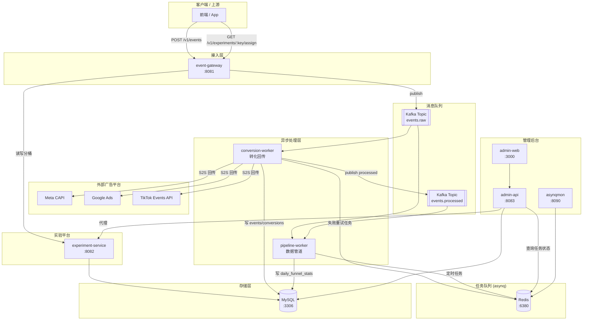
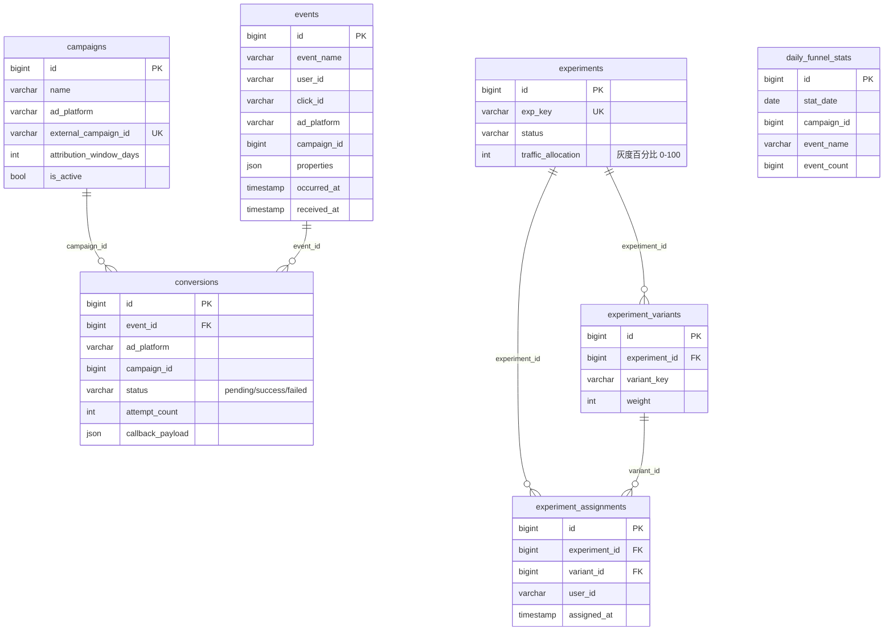
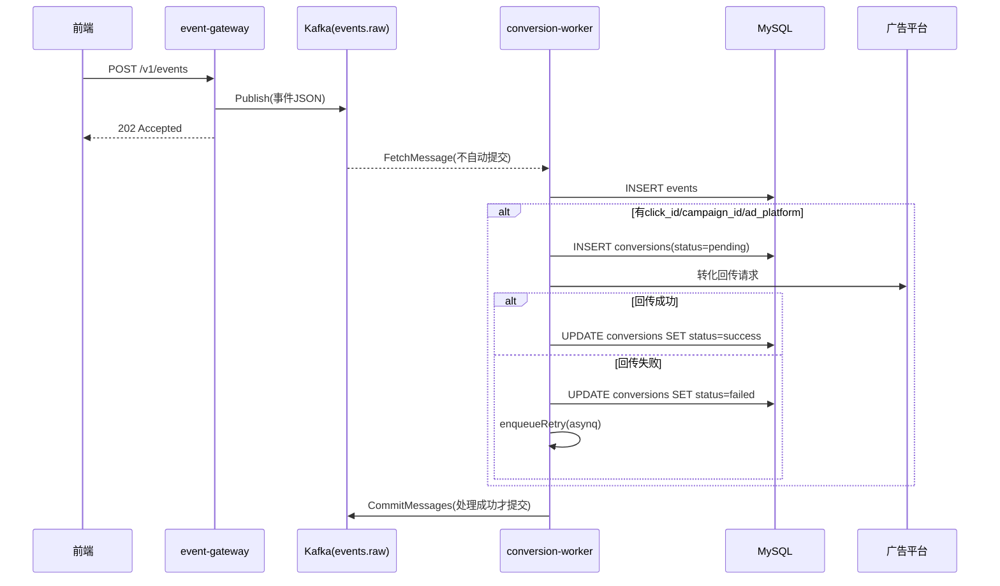
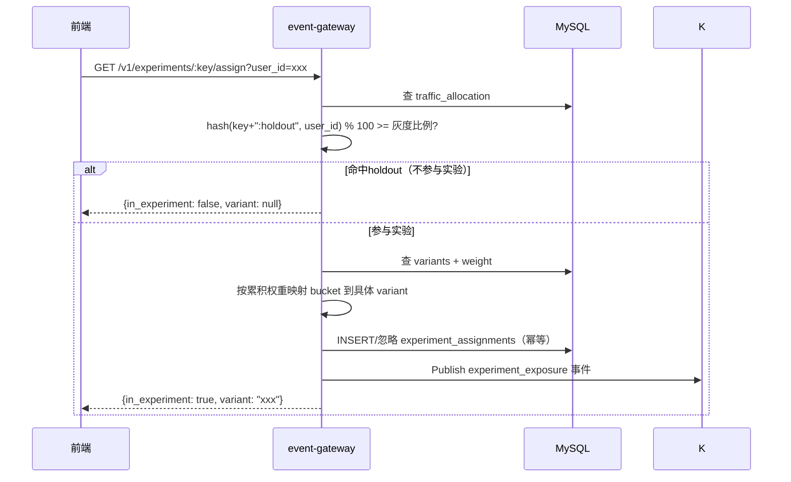

# 02. 系统架构设计

## 1. 整体架构图

## 2. 技术栈与选型理由

| 组件 | 选型 | 理由 |
|---|---|---|
| 语言 | Go 1.25 | 高并发 I/O 密集场景表现好，编译产物单一二进制，适合多服务微服务化部署 |
| HTTP 框架 | Gin | 轻量、生态成熟，团队熟悉度高 |
| 消息队列 | Kafka | 需要多消费者独立消费同一份事件流（回传 + 管道两条线），且要求可重放；对比 Redis Stream/RabbitMQ，Kafka 在"多消费者组独立 offset + 高吞吐持久化"上更合适 |
| 异步任务队列 | asynq (Redis) | 用于"失败重试"和"定时任务"这类偏任务调度语义的场景，和 Kafka 的"事件流"语义分工明确，不混用 |
| 数据库 | MySQL 8.0 | 团队现有运维能力覆盖，事务/外键约束满足强一致性需求（如 conversions 外键关联 events） |
| 迁移工具 | golang-migrate | 版本化 schema 迁移，`migrations/0001_init.up.sql` / `.down.sql` 成对提供回滚能力 |
| 后台前端 | Next.js (App Router) | Server Component 直接查后端聚合数据，无需额外 BFF 层 |

## 3. 服务清单与端口

| 服务 | 类型 | 端口（宿主机） | 职责 |
|---|---|---|---|
| `event-gateway` | HTTP | 8081→8080 | 事件打点接收、实验分流请求入口 |
| `conversion-worker` | Kafka 消费者 + asynq worker | 无对外端口 | 消费 `events.raw`，落库 + 触发广告转化回传，失败重试 |
| `pipeline-worker` | Kafka 消费者 + asynq scheduler/worker | 无对外端口 | 消费 `events.processed`，定时汇总每日漏斗统计 |
| `experiment-service` | HTTP | 8082→8080 | 实验/变体 CRUD、统计显著性与 SRM 检测 |
| `admin-api` | HTTP | 8083→8080 | 后台聚合查询、代理转发实验服务、queue 状态查询 |
| `admin-web` | Next.js | 3000 | 可视化后台 |
| `asynqmon` | 第三方 UI | 8090 | Redis 任务队列可视化（内置组件，非本项目自研） |
| `mysql` / `redis` / `kafka` | 基础设施 | 3306 / 6380 / 9092 | 存储与中间件 |

## 4. 数据模型（ER 图）

## 5. 关键数据流时序图

### 5.1 事件上报 → 转化回传

### 5.2 实验分流

## 6. 关键设计要点（面试/评审常被追问的点）

| 设计点 | 做法 | 为什么这么做 |
|---|---|---|
| Kafka 消费语义 | Fetch 不自动提交 → 处理成功才 Commit | 避免"取到消息即视为已消费"导致进程崩溃时丢数据（详见 [01 SOP 中 ADR-001](01-build-sop.md)） |
| 优雅关闭 | `signal.NotifyContext` 只 gate 下一次 Fetch，已取到的消息始终用 `context.Background()` 跑完 | 避免两种极端：硬杀丢数据 / 关闭信号打断正在写库的事务 |
| 确定性分桶 | `murmur3(experimentKey+userID)` → `[0,10000)` 区间，按变体权重累积映射阈值区间 | 同一用户每次请求结果一致，且避免"哈希后再取模"引入的分布偏差 |
| 灰度与分桶解耦 | holdout 判断用独立的 `key+":holdout"` 加盐哈希，不复用分桶哈希 | 保证调整流量灰度比例不会连带改变已进组用户的分组结果 |
| 转化去重 | `EventID` 贯穿 events 表主键 → 广告平台 `event_id` 字段 | 满足 Meta/TikTok 官方要求的像素+服务端双路径去重匹配 |
| 统计显著性 | Wilson score 置信区间（而非正态近似） | 小样本/极端转化率下更稳健，是 GrowthBook 等平台的标准做法 |
| SRM 检测 | 卡方拟合优度检验，p<0.01 判定异常 | 行业标准阈值，帮助在看转化率之前先验证"分流本身有没有 bug" |
