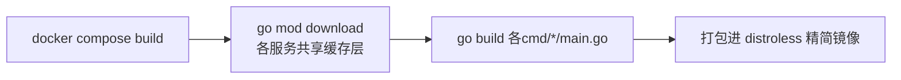

# 03. 快速上手教程（10 分钟跑通全链路）

> 本教程假设你在 Windows + Git Bash 环境（与本仓库开发环境一致），已安装 **Docker Desktop**。全程只需要 `docker compose`，不需要本地装 Go/Node。
>
> 说明：本文档中的"截图"以 ASCII 线框图 + 真实命令行输出代替——请在自己机器上跟着操作，实际界面会更丰富（颜色、表格样式等）。

## 第一步：环境检查

```bash
docker --version
docker compose version
```

预期输出类似：

```
Docker version 27.x.x
Docker Compose version v2.x.x
```

如果 `docker compose` 命令找不到，说明用的是旧版 Docker，需要用 `docker-compose`（带中划线）替代下面所有命令。

## 第二步：构建镜像

在项目根目录执行：

```bash
cd meshy-growth-backend
docker compose build
```

**这一步在做什么**：为 7 个自研服务（event-gateway、conversion-worker、pipeline-worker、experiment-service、admin-api、admin-web、migrate）分别构建 Docker 镜像。首次构建约 2-5 分钟（取决于网络），后续增量构建走缓存会快很多。



## 第三步：启动全部服务

```bash
docker compose up -d
```

`-d` 表示后台运行。启动顺序由 `depends_on` + `healthcheck` 保证——MySQL/Kafka/Redis 先起并等待健康检查通过，`migrate` 服务跑完数据库迁移后自动退出，再拉起业务服务。

查看启动状态：

```bash
docker compose ps
```

预期看到类似（`STATUS` 都应是 `Up`，基础设施还应带 `(healthy)`）：

```
NAME                                        STATUS
meshy-growth-backend-admin-api-1            Up
meshy-growth-backend-admin-web-1            Up
meshy-growth-backend-conversion-worker-1    Up
meshy-growth-backend-event-gateway-1        Up
meshy-growth-backend-experiment-service-1   Up
meshy-growth-backend-kafka-1                Up (healthy)
meshy-growth-backend-mysql-1                Up (healthy)
meshy-growth-backend-pipeline-worker-1      Up
meshy-growth-backend-redis-1                Up (healthy)
```

> ⚠️ 如果有服务反复 `Restarting`，直接跳到 [06 调试手册](06-debugging-guide.md) 的"服务起不来"一节。

## 第四步：健康检查

```bash
curl http://localhost:8081/healthz   # event-gateway
curl http://localhost:8082/healthz   # experiment-service
curl http://localhost:8083/healthz   # admin-api
```

每个都应返回纯文本 `ok`。

## 第五步：灌入示例数据

项目自带一个 seed 脚本，会模拟 200 个用户的打点、点击、转化、实验分流流量：

```bash
docker compose run --rm seed
```

预期输出：

```
2026/08/15 xx:xx:xx seeding traffic for 200 users...
2026/08/15 xx:xx:xx seeding complete
```

这一步跑完后，事件、转化、实验分组数据就都产生了，后面几步是"验证/查看"。

## 第六步：打开管理后台

浏览器访问 **http://localhost:3000**

线框图（实际页面为浅色卡片风格 + Tailwind 样式）：

```
┌─────────────────────────────────────────────────────────┐
│  meshy-growth-backend admin           [Events] [Conversions] [Campaigns] [Experiments] │
├─────────────────────────────────────────────────────────┤
│  概览指标卡片                                              │
│  ┌────────────┐ ┌────────────┐ ┌────────────┐            │
│  │ 今日事件数  │ │ 转化成功率  │ │ 队列积压    │            │
│  │   2,202    │ │   66.7%    │ │    0       │            │
│  └────────────┘ └────────────┘ └────────────┘            │
└─────────────────────────────────────────────────────────┘
```

依次点开各页面，验证以下内容都能正常渲染（无报错、无空白页）：

| 页面 | 路由 | 应该看到什么 |
|---|---|---|
| 首页概览 | `/` | 关键指标汇总 |
| 事件列表 | `/events` | 最近 100 条打点事件 |
| 转化列表 | `/conversions` | 转化状态（success/failed/pending）及重试次数 |
| 广告计划 | `/campaigns` | 已配置的广告计划，可新建 |
| 实验列表 | `/experiments` | 已创建的实验，点进去看详情 |
| 实验详情 | `/experiments/checkout_button_color` | 各变体的分配人数、转化率、置信区间、SRM 检测结果 |

实验详情页线框（有 SRM 异常时会出现红色告警条）：

```
┌─────────────────────────────────────────────────────────┐
│ ← Back to experiments                                    │
│  Checkout Button Color                                   │
│  checkout_button_color · running · goal event: purchase  │
├─────────────────────────────────────────────────────────┤
│ [若SRM异常] ⚠ Sample Ratio Mismatch detected...           │
├──────────┬──────┬────────┬─────────┬───────┬──────┬──────┤
│ Variant  │Weight│Assigned│Converted│ Rate  │ 95%CI│p-val │
├──────────┼──────┼────────┼─────────┼───────┼──────┼──────┤
│ control  │  50  │   91   │   55    │60.4%  │50-70%│  -   │
│ treatment│  50  │  109   │   69    │63.3%  │54-72%│0.678 │
└──────────┴──────┴────────┴─────────┴───────┴──────┴──────┘
```

## 第七步：发送你自己的第一个事件

```bash
curl -X POST http://localhost:8081/v1/events \
  -H "Content-Type: application/json" \
  -d '{
    "event_name": "purchase",
    "user_id": "tutorial-user-1",
    "click_id": "demo-click-1",
    "ad_platform": "meta",
    "campaign_id": 1,
    "properties": {"value": 199}
  }'
```

预期响应：

```json
{"status":"queued"}
```

几秒后可以在 admin-web 的 `/events` 页面看到这条新事件；如果配了 `click_id`+`ad_platform`+`campaign_id`，`/conversions` 页面也会出现对应的转化记录（`status` 会是 `success` 或 `failed`，`failed` 是正常的——本项目 stub 了 15% 概率的模拟失败，用来演示重试链路）。

## 第八步：创建你自己的第一个实验

```bash
curl -X POST http://localhost:8082/v1/experiments \
  -H "Content-Type: application/json" \
  -d '{
    "key": "my_first_experiment",
    "name": "My First Experiment",
    "traffic_allocation": 100,
    "variants": [
      {"key": "control", "name": "Control", "weight": 50},
      {"key": "treatment", "name": "Treatment", "weight": 50}
    ]
  }'
```

然后模拟几个用户请求分组：

```bash
for i in 1 2 3 4 5; do
  curl -s "http://localhost:8081/v1/experiments/my_first_experiment/assign?user_id=user-$i"
  echo
done
```

预期看到每个用户被稳定分到 `control` 或 `treatment`（同一个 user_id 反复请求，结果不会变）。

## 第九步：清理环境

**只停止服务（保留数据，下次 `up -d` 秒起）：**

```bash
docker compose stop
```

**彻底清理（删除容器和数据卷，回到全新状态）：**

```bash
docker compose down -v
```

> `-v` 会删掉 MySQL 数据卷，谨慎使用——详见 [执行安全提示]。这是不可逆操作，执行前请确认真的要清空数据。

## 常见"新手第一次跑"的坑

| 现象 | 原因 | 解决 |
|---|---|---|
| `docker compose up -d` 后 `migrate` 一直 `Waiting` | MySQL 健康检查还没过 | 等几十秒，或 `docker compose logs mysql` 看是否报错 |
| `seed` 报连接拒绝 | event-gateway/experiment-service 还没完全起来就跑了 seed | 先 `docker compose ps` 确认都 `Up` 再跑 seed |
| admin-web 打开空白/500 | admin-api 或 experiment-service 没起来 | 看 [06 调试手册](06-debugging-guide.md) |
| 端口冲突（3306/6380/9092/3000 等被占用） | 本机已有其他服务占用同端口 | 改 `docker-compose.yml` 里对应的宿主机端口映射 |

下一步：接入自己的业务打点，请看 [04 API 使用手册](04-api-guide.md)。
