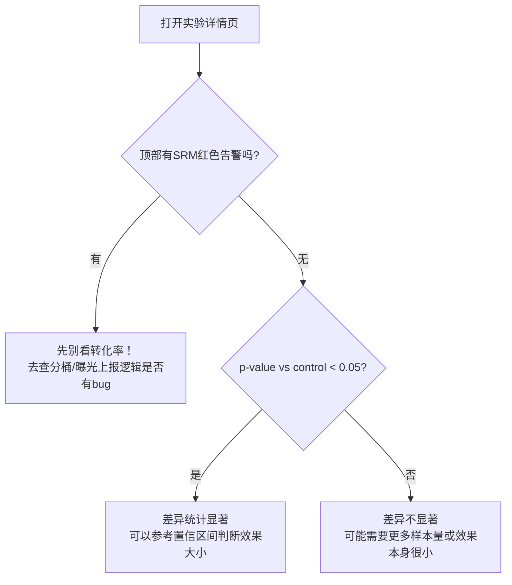

# 05. 后台管理界面操作手册（admin-web）

> 面向增长/运营/投放同学，不需要懂代码，跟着页面操作即可。访问地址：**http://localhost:3000**（生产环境地址由部署方提供）。

## 导航总览

```
┌────────────────────────────────────────────────────────────┐
│  Events   Conversions   Campaigns   Experiments              │
└────────────────────────────────────────────────────────────┘
```

打开首页会自动跳转到 **Events** 页。四个一级导航对应四个核心域：打点事件、转化回传、广告计划、实验。

---

## 1. Events（事件流水）

**路径**：`/events`

```
┌────────────────────────────────────────────────────────────────────┐
│ Events                                                               │
├──────┬────────────┬──────────┬──────────┬──────────┬───────────────┤
│ ID   │ Event Name │ User ID  │ Click ID │ Platform │ Occurred At   │
├──────┼────────────┼──────────┼──────────┼──────────┼───────────────┤
│ 2202 │ purchase   │ u-10086  │ gclid-.. │ google   │ 2026-08-15 .. │
│ 2201 │ page_view  │ u-10085  │          │          │ 2026-08-15 .. │
│ ...  │            │          │          │          │               │
└──────┴────────────┴──────────┴──────────┴──────────┴───────────────┘
```

**用途**：查看最近 100 条打点事件，用于验证"我刚才埋的点有没有上报成功"。

**怎么用**：
1. 触发一次前端埋点（或用 [04 API 手册](04-api-guide.md) 里的 curl 命令手动发一条）
2. 刷新本页面，几秒内应该能看到新记录（Event Name / User ID 与你发的一致）
3. 如果一直看不到 → 去 [06 调试手册](06-debugging-guide.md) 排查

---

## 2. Conversions（转化回传监控）

**路径**：`/conversions`

```
┌────────────────────────────────────────────────────────────────────┐
│ Conversion Callbacks                              [刷新按钮]         │
├────────────────────────────────────────────────────────────────────┤
│ ┌────────┐  ┌────────┐  ┌────────┐                                  │
│ │  success│  │ failed │  │ pending│    ← 状态汇总卡片                │
│ │  1489  │  │   23   │  │   0    │                                  │
│ └────────┘  └────────┘  └────────┘                                  │
├────────────────────────────────────────────────────────────────────┤
│ Retry Queue Status (asynq — full detail at localhost:8090)          │
│ pending active scheduled retry archived completed processed failed  │
│   0       0       2        3      0        1489       1512     23   │
├────────────────────────────────────────────────────────────────────┤
│ Platform │Campaign│ClickID │ Status │Attempts│LastError │ Updated   │
│ google   │  1     │gclid-..│ success│   1    │          │ 08-15 ..  │
│ meta     │  2     │fbc-... │ failed │   2    │simulated.│ 08-15 ..  │
└────────────────────────────────────────────────────────────────────┘
```

**关键字段解读**：

| 字段 | 含义 | 什么时候要关注 |
|---|---|---|
| `success` / `failed` / `pending` 汇总卡片 | 转化回传的整体成功率 | `failed` 占比长期 > 15%-20% 说明不是随机抖动，要排查 |
| Retry Queue Status | asynq 任务队列的实时状态 | `retry` 数值持续走高不回落 = 有系统性故障；点右上角提示可跳到 **asynqmon**（http://localhost:8090）看更细的任务详情 |
| `Last Error` 列 | 该条转化最后一次失败的错误信息 | 排障时第一个看的字段 |

**典型运营场景：核对某个广告计划的回传成功率**
1. 在本页面用浏览器 `Ctrl+F` 搜索对应的 `Campaign` ID（或去 Campaigns 页确认 ID）
2. 观察该 campaign 下的转化记录状态分布
3. 如果发现某个平台（如 google）失败率明显偏高，去 [06 调试手册](06-debugging-guide.md) 的"广告回传格式核对"一节排查

---

## 3. Campaigns（广告计划管理）

**路径**：`/campaigns`

```
┌────────────────────────────────────────────────────────────────────┐
│ Campaigns                                                            │
├─────────────────┬──────────┬────────────────┬───────────┬──────────┤
│ Name             │ Platform │ External ID    │ Attr.Window│ Active  │
├─────────────────┼──────────┼────────────────┼───────────┼──────────┤
│ 618大促-谷歌搜索  │ google   │ google-camp-001│    7d     │  Yes    │
├─────────────────┴──────────┴────────────────┴───────────┴──────────┤
│ New Campaign                                                         │
│ [Name______] [platform▾] [External Campaign ID___] [Attr天数_] [Create]│
└────────────────────────────────────────────────────────────────────┘
```

**怎么新建一个广告计划**：
1. 填写 `Name`（内部展示名，随意取）
2. 选择 `ad_platform`（下拉框：meta / google / tiktok）
3. 填写 `External Campaign ID`（**必须和广告平台后台的真实计划 ID 一致**，否则转化回传会关联错计划）
4. 填写归因窗口天数（默认 7 天，即点击后 7 天内的转化都算这个计划的）
5. 点击 `Create`，页面会自动刷新显示新计划

> ⚠️ `External Campaign ID` 是唯一约束字段（数据库层面），重复创建同一个 ID 会报错。

---

## 4. Experiments（实验管理）

### 4.1 实验列表

**路径**：`/experiments`

```
┌────────────────────────────────────────────────────────────────────┐
│ Experiments                                                          │
├──────────────────────┬──────────────────┬─────────┬─────────────────┤
│ Key                   │ Name             │ Status  │ Traffic Alloc. │
├──────────────────────┼──────────────────┼─────────┼─────────────────┤
│ checkout_button_color │ 结算按钮颜色      │ running │      100%       │
└──────────────────────┴──────────────────┴─────────┴─────────────────┘
```

点击某一行的 Key 进入详情页。

> 目前 admin-web **暂不支持在页面上直接创建实验**（这是 P1 待办，见文末"已知限制"），新建实验需要调用 API，见 [04 API 手册 2.1 节](04-api-guide.md#21-post-v1experiments--创建实验)。

### 4.2 实验详情（核心页面）

**路径**：`/experiments/[key]`，例如 `/experiments/checkout_button_color`

```
┌────────────────────────────────────────────────────────────────────┐
│ ← Back to experiments                                                │
│ 结算按钮颜色                                                          │
│ checkout_button_color · running · goal event: purchase              │
├────────────────────────────────────────────────────────────────────┤
│ ⚠ Sample Ratio Mismatch detected: observed assignment split         │  ← 仅SRM异常时出现
│   diverges from configured weights (chi-square 12.35, p=0.0004).    │
│   Assignment/bucketing logic may have a bug — treat results below   │
│   with caution.                                                     │
├───────────────┬──────┬────────┬─────────┬───────┬───────────┬───────┤
│ Variant        │Weight│Assigned│Converted│ Rate  │ 95% CI    │p-val  │
├───────────────┼──────┼────────┼─────────┼───────┼───────────┼───────┤
│ 蓝色(control)  │  50  │   91   │   55    │ 60.4% │50.2%-69.9%│  -    │
│ 橙色(treatment)│  50  │  109   │   69    │ 63.3% │53.9%-71.8%│0.6778 │
└───────────────┴──────┴────────┴─────────┴───────┴───────────┴───────┘
```

**看这个页面时该怎么下结论？三步判断法**：



**字段速查**：

| 字段 | 通俗解释 |
|---|---|
| Assigned | 这个变体分到了多少用户 |
| Converted | 这些用户里有多少人做了目标事件（默认 `purchase`，可在 URL 后加 `?goal_event=xxx` 换成其他事件口径，但目前 admin-web 页面写死了 `purchase`，换口径需直接调 API） |
| Rate | 转化率 |
| 95% CI | 转化率的置信区间——**两个变体的区间大幅重叠，即使 Rate 数字不同，也大概率不是真实差异** |
| p-val | 与对照组比较的显著性检验结果 |

---

## 5. 关联工具：asynqmon（任务队列可视化）

**路径**：http://localhost:8090（独立服务，非本项目自研，是开源组件 [hibiken/asynqmon](https://github.com/hibiken/asynqmon)）

用于查看转化重试任务的详细执行历史、手动重跑失败任务。当 Conversions 页面看到 `retry`/`failed` 数值异常时，来这里深挖具体是哪几条任务、失败原因是什么。

---

## 已知限制（当前版本）

- 实验创建/编辑目前只能通过 API，admin-web 还没有可视化建实验的表单（Roadmap 候选项）
- `goal_event` 目前页面写死为 `purchase`，如需换口径请直接调 [04 API 手册](04-api-guide.md) 的 stats 接口
- 页面数据均为 Server Component 直出，不支持自动轮询刷新（Conversions 页有手动刷新按钮，其余页面需手动刷新浏览器）
