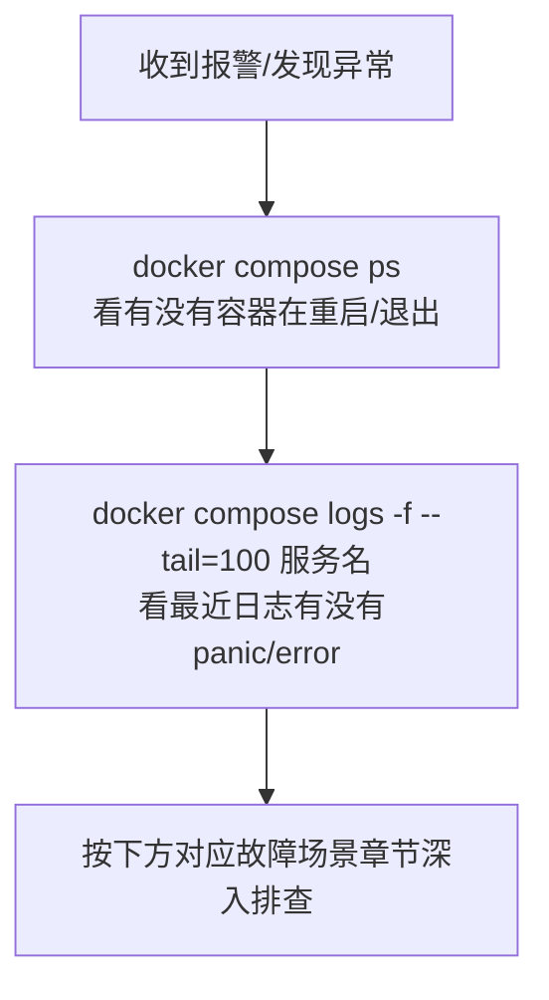
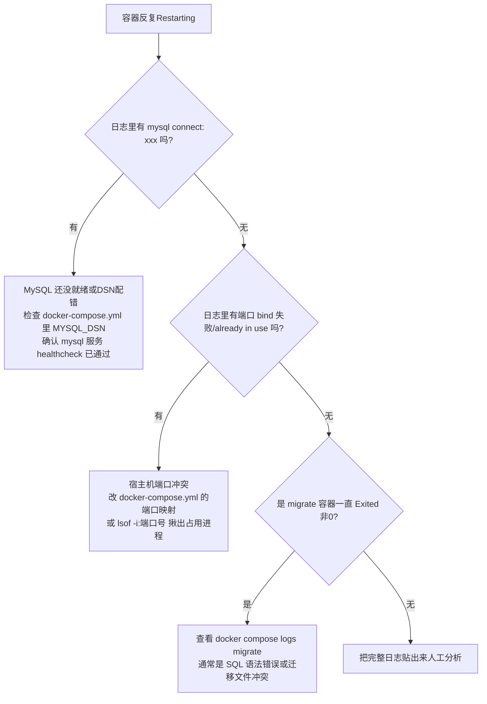
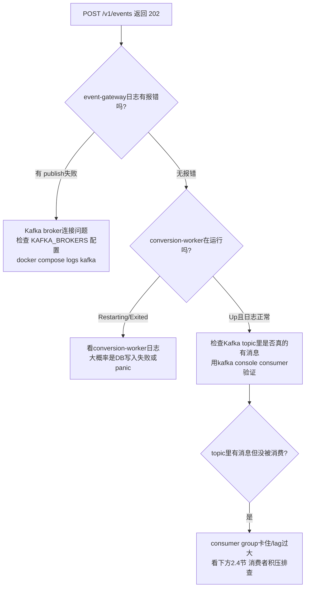
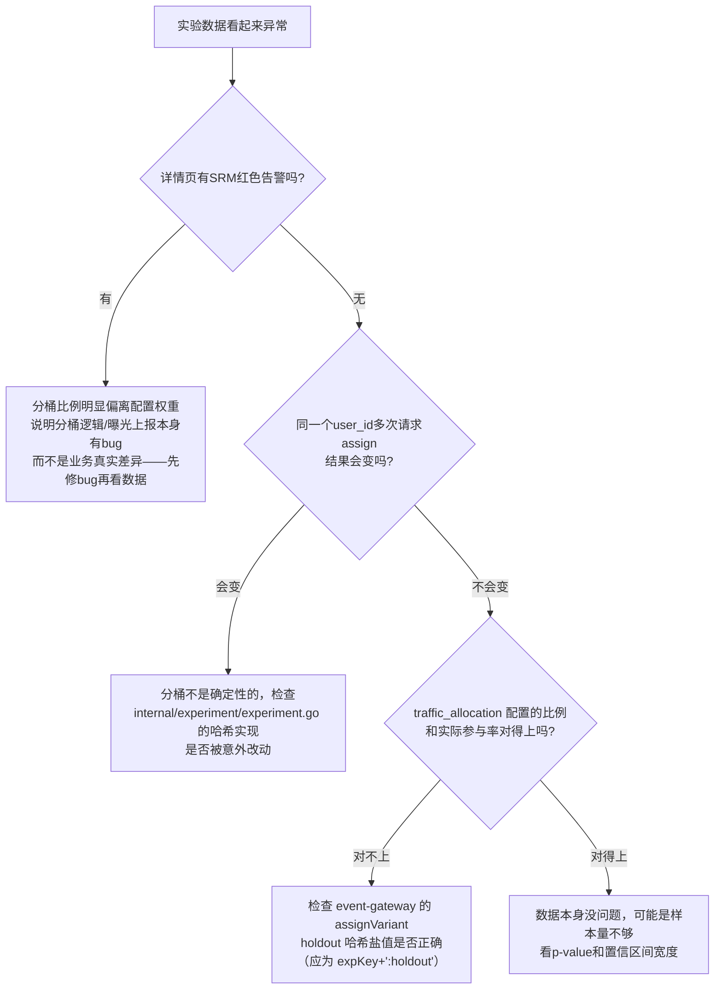

# 06. 调试与故障排查手册

> 面向研发 / on-call 同学。本手册按"先看什么、再看什么"的顺序组织，每一节都配了可以直接复制执行的命令。

## 0. 排障总原则（先做这三步，再深入）



```bash
# 1. 看整体健康度
docker compose ps

# 2. 看某服务最近日志（-f 持续跟踪，Ctrl+C 退出）
docker compose logs -f --tail=100 conversion-worker

# 3. 看所有服务最近的报错关键字
docker compose logs --since 10m | grep -iE "panic|fatal|error"
```

---

## 1. 服务级排障速查表

| 服务 | 健康检查 | 关键日志关键字 | 常见故障 |
|---|---|---|---|
| event-gateway | `curl localhost:8081/healthz` | `[GIN]`、`event-gateway listening` | 端口冲突、MySQL/Kafka 未就绪 |
| conversion-worker | 看日志有无持续输出 | `conversion %d send failed`、`shutting down gracefully` | Kafka broker 不可达、DB 写入失败 |
| pipeline-worker | 看日志有无持续输出 | `Scheduler starting`、`shutting down gracefully` | 同上 |
| experiment-service | `curl localhost:8082/healthz` | `[GIN]` | DB 连接失败、`traffic_allocation` 越界 |
| admin-api | `curl localhost:8083/healthz` | `[GIN]` | 代理 experiment-service 502（说明后者没起来）|
| admin-web | `curl -I localhost:3000` | Next.js 启动日志 | `ADMIN_API_URL` 配置错误、admin-api 未就绪 |
| mysql/redis/kafka | `docker compose ps`（看 healthy） | 各自官方日志格式 | 端口被本机其他进程占用、数据卷权限问题 |

---

## 2. 场景化故障树

### 2.1 场景：容器起不来 / 反复 Restarting

```bash
docker compose ps
docker compose logs <服务名> --tail=50
```



**排查命令**：

```bash
# MySQL是否真的健康
docker compose ps mysql
docker compose exec mysql mysqladmin ping -h localhost -uapp -papp

# 迁移是否成功跑完（Exited (0) 才是正常）
docker compose ps migrate
docker compose logs migrate
```

### 2.2 场景：事件发了，但 admin-web / MySQL 里查不到



**验证 Kafka 里确实收到了消息**（绕开消费者，直接看 topic）：

```bash
docker compose exec kafka /opt/kafka/bin/kafka-console-consumer.sh \
  --bootstrap-server localhost:9092 \
  --topic events.raw \
  --from-beginning \
  --max-messages 5
```

如果这里能看到你发的事件 JSON，说明 event-gateway → Kafka 这段没问题，问题在 `conversion-worker` 消费侧；如果这里也看不到，问题在 `event-gateway` → Kafka 发布这段。

### 2.3 场景：转化一直失败（status=failed）

**第一步：区分"正常的模拟失败"还是"真实故障"**

> 本项目 `internal/adplatform/client.go` 的 `simulateOutcome()` 故意有 **15% 概率**返回模拟失败，用于演示重试链路——这是设计如此，不是 bug。判断标准：失败率长期显著高于 ~15%，或 `last_error` 不是 `simulated transient error from ad platform`，才需要深挖。

```bash
# 查看真实的失败率
docker compose exec mysql mysql -uapp -papp growth -e \
  "SELECT status, COUNT(*) FROM conversions GROUP BY status;"

# 查看非模拟错误的失败记录
docker compose exec mysql mysql -uapp -papp growth -e \
  "SELECT id, ad_platform, last_error FROM conversions \
   WHERE status='failed' AND last_error NOT LIKE '%simulated%' LIMIT 20;"
```

**第二步：核对回传 payload 格式是否符合广告平台规范**（见下节）

### 2.4 场景：广告回传格式核对 / 消费者积压排查

**核对某个平台的实际回传 payload**：

```bash
docker compose exec mysql mysql -uapp -papp growth -e \
  "SELECT id, callback_payload FROM conversions \
   WHERE ad_platform='google' AND callback_payload IS NOT NULL \
   ORDER BY id DESC LIMIT 1\G"
```

对照 [02 架构设计文档](02-architecture.md) 第 6 节的字段要求人工核对，重点检查：

| 平台 | 必须检查的字段 |
|---|---|
| google | `conversion_action` 是否为 `customers/{id}/conversionActions/{id}` 资源名格式；`conversion_date_time` 是否为 `yyyy-MM-dd HH:mm:ss+HH:MM`（空格分隔，不是 `T`） |
| tiktok | `user`/`ad.ttclid` 是否嵌套在 `context` 对象下；字段名是否是 `timestamp` 而不是 `event_time` |
| meta / tiktok | `event_id` 是否非空（用于像素+服务端双路径去重） |

**消费者积压排查**（Kafka consumer group lag）：

```bash
docker compose exec kafka /opt/kafka/bin/kafka-consumer-groups.sh \
  --bootstrap-server localhost:9092 \
  --describe --group conversion-worker
```

关注 `LAG` 列，持续增长说明消费速度跟不上生产速度，需要看 `conversion-worker` 是不是卡在某个慢操作（多半是 DB 慢查询或下游 HTTP 超时）。

### 2.5 场景：实验分组结果"看起来不对"



**手动验证分桶确定性**：

```bash
for i in 1 2 3; do
  curl -s "http://localhost:8081/v1/experiments/checkout_button_color/assign?user_id=debug-user-1"
  echo
done
# 三次结果应完全一致
```

**手动验证灰度比例（用大量不同 user_id 统计比例）**：

```bash
for i in $(seq 1 200); do
  curl -s "http://localhost:8081/v1/experiments/checkout_button_color/assign?user_id=probe-$i"
  echo
done > /tmp/probe.txt
grep -c '"in_experiment":true' /tmp/probe.txt
grep -c '"in_experiment":false' /tmp/probe.txt
# 两者比例应约等于配置的 traffic_allocation
```

### 2.6 场景：admin-web 打开报 500 / 页面空白

```bash
# admin-web自身日志
docker compose logs admin-web --tail=50

# 它依赖的admin-api是否正常
curl http://localhost:8083/healthz
curl http://localhost:8083/v1/experiments

# admin-api依赖的experiment-service是否正常（admin-api会代理转发）
curl http://localhost:8082/healthz
```

500 通常是链路上某一环没起来，按 `admin-web → admin-api → experiment-service/MySQL` 的依赖顺序逐层排查。

---

## 3. 优雅关闭 / 数据不丢失 验证方法

这是发布/重启前**必须**验证的一步，尤其是改动过 Kafka 消费逻辑之后。

```bash
# 1. 记录重启前的数据总量
docker compose exec mysql mysql -uapp -papp growth -e \
  "SELECT COUNT(*) FROM events; SELECT COUNT(*) FROM conversions;"

# 2. 重启目标服务，同时观察日志
docker compose restart conversion-worker
docker compose logs conversion-worker --since 30s

# 3. 重启后再次核对数据总量，应该只增不丢（不会突然减少或出现明显缺口）
docker compose exec mysql mysql -uapp -papp growth -e \
  "SELECT COUNT(*) FROM events; SELECT COUNT(*) FROM conversions;"
```

**日志里应该看到什么算正常**：

```
2026/08/15 xx:xx:xx shutting down gracefully
asynq: pid=1 ... INFO: Starting graceful shutdown
asynq: pid=1 ... INFO: All workers have finished
asynq: pid=1 ... INFO: Exiting
2026/08/15 xx:xx:xx conversion-worker started, consuming events.raw
```

**如果看到这些，说明有问题**：

| 异常日志 | 含义 |
|---|---|
| `panic: ...` | 代码有未处理的异常，需要立即定位堆栈 |
| 重启后数据量不增反减 | 严重问题，可能是误操作了 `docker compose down -v`（删了数据卷） |
| 长时间卡在 "shutting down" 不退出 | 有消息处理逻辑卡死（比如下游 HTTP 请求没设超时），需要检查是否需要加超时保护 |

---

## 4. 常用调试命令合集（速查）

```bash
# ── 容器与日志 ──────────────────────────
docker compose ps                                  # 整体状态
docker compose logs -f <服务名>                     # 实时日志
docker compose logs --since 10m <服务名>             # 最近10分钟日志
docker compose restart <服务名>                      # 重启单个服务（验证优雅关闭用）
docker compose exec <服务名> sh                      # 进容器（distroless镜像没有shell，仅mysql/redis/kafka可用）

# ── MySQL ──────────────────────────────
docker compose exec mysql mysql -uapp -papp growth
docker compose exec mysql mysql -uapp -papp growth -e "SHOW TABLES;"
docker compose exec mysql mysql -uapp -papp growth -e "SELECT * FROM events ORDER BY id DESC LIMIT 5\G"

# ── Redis / asynq ──────────────────────
docker compose exec redis redis-cli ping
docker compose exec redis redis-cli keys "asynq:*"
# 更推荐直接打开可视化: http://localhost:8090 (asynqmon)

# ── Kafka ──────────────────────────────
# 列出所有topic
docker compose exec kafka /opt/kafka/bin/kafka-topics.sh --bootstrap-server localhost:9092 --list
# 查看某topic的消费者组lag
docker compose exec kafka /opt/kafka/bin/kafka-consumer-groups.sh \
  --bootstrap-server localhost:9092 --describe --group conversion-worker
# 直接消费查看消息内容（调试用，不会影响真实消费者的offset）
docker compose exec kafka /opt/kafka/bin/kafka-console-consumer.sh \
  --bootstrap-server localhost:9092 --topic events.raw --from-beginning --max-messages 5

# ── HTTP接口探活 ────────────────────────
curl http://localhost:8081/healthz
curl http://localhost:8082/healthz
curl http://localhost:8083/healthz
```

---

## 5. 验收测试清单（发布前必过）

对应 [01 建设 SOP](01-build-sop.md) 阶段 5 的测试验证环节，这是本项目最近一轮优化后实际执行过的验收步骤，可作为每次发布的回归清单：

- [ ] `docker compose build` 全部服务成功，无编译错误
- [ ] `docker compose up -d` 后 `docker compose ps` 所有服务 `Up`（基础设施带 `healthy`）
- [ ] `docker compose run --rm seed` 跑通不报错
- [ ] 日志中无 `panic`/`fatal`：`docker compose logs --since 5m | grep -iE "panic|fatal"`
- [ ] 分别 `docker compose restart` 每个长驻服务，日志出现优雅关闭字样，且重启前后数据总量无缺口
- [ ] 用不同 `traffic_allocation` 建实验，实测参与率与配置比例吻合（±10% 合理波动范围内，样本量 200+ 时）
- [ ] 三个广告平台的 `callback_payload` 字段结构核对通过（见 2.4 节表格）
- [ ] `/v1/experiments/:key/stats` 返回的 `conversion_rate`/`confidence_interval`/`p_value_vs_control`/`srm_check` 数值均在合理范围（p 值 0-1 之间、卡方值非负）
- [ ] admin-web 全部页面（`/events` `/conversions` `/campaigns` `/experiments` `/experiments/[key]`）访问返回 200，无控制台报错
