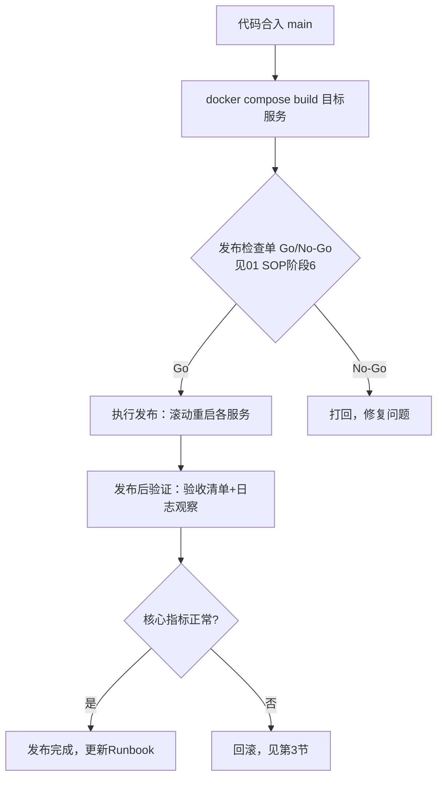
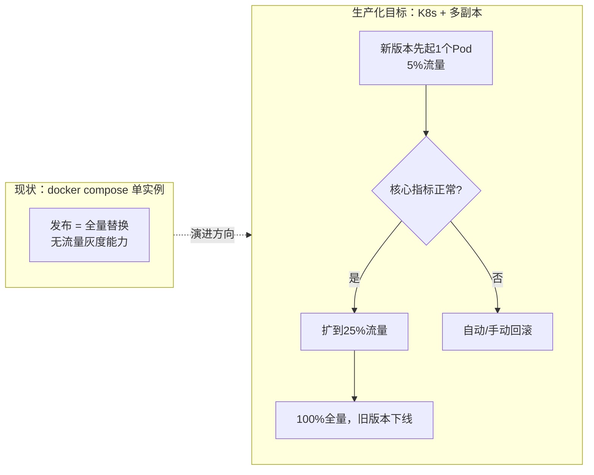
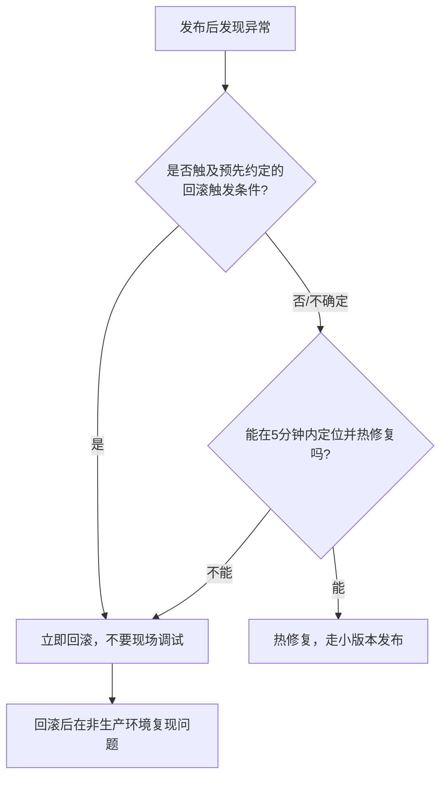

# 07. 发布与运维手册

> 面向研发 / SRE。覆盖发布前准备、灰度策略、优雅重启操作、回滚、监控看板现状与规划。本项目当前是 **单机 `docker compose` 部署**（无 K8s、无镜像仓库、无多副本），下文会诚实标注"现状是什么"和"生产化后建议怎么做"，不混为一谈。

## 0. 发布方式全景图



---

## 1. 发布前准备（Pre-release Checklist）

在执行任何发布前，先过一遍 [01 建设 SOP 阶段 6](01-build-sop.md#阶段-6灰度发布与上线) 的 Go/No-Go Checklist，再叠加以下运维侧检查：

- [ ] 确认这次发布改动了哪些服务（避免"重建了所有镜像但其实只改了一个服务"，浪费发布窗口时间）
- [ ] 确认数据库迁移（如有）已经过评审，且是**向后兼容**的（新迁移跑完后，旧版本代码不应该直接崩溃——这样才能做到"先迁移、再滚动发布代码"两步分离，而不是强耦合的单次发布）
- [ ] 确认本地/预发环境已经跑过一遍 [06 调试手册 · 验收测试清单](06-debugging-guide.md#5-验收测试清单发布前必过)
- [ ] 确认有人对 `docker compose logs -f` 保持关注（本项目目前没有接入外部告警渠道，发布期间的异常发现完全依赖人工盯屏）
- [ ] 明确本次发布的**回滚触发条件**（例如："转化失败率超过 30% 持续 5 分钟"、"任一服务连续 3 次健康检查失败"），提前想好比出问题之后再纠结要不要回滚更好

---

## 2. 发布执行

### 2.1 现状：单实例滚动重启

本项目 `docker-compose.yml` 里每个服务都是单副本（没有 `deploy.replicas`），也没有反向代理/负载均衡层做流量切分，所以**当前唯一可行的发布方式是"停旧启新"的滚动重启**，重启期间该服务会有几秒到十几秒的不可用窗口：

```bash
# 1. 重新构建改动过的服务镜像（只传目标服务名，不要每次都全量build，节省时间）
docker compose build event-gateway conversion-worker

# 2. 逐个重启，观察日志确认优雅关闭 + 正常启动（不要一次性重启所有服务）
docker compose up -d --no-deps event-gateway
docker compose logs -f --tail=30 event-gateway

docker compose up -d --no-deps conversion-worker
docker compose logs -f --tail=30 conversion-worker
```

> `--no-deps` 很重要：不加的话 `docker compose up -d` 可能会连带尝试重建它依赖的服务（如 mysql/kafka），发布一个业务服务不应该动到基础设施容器。

**为什么可以接受这种"硬切换"而不丢数据**：本项目已经做了 [D 项优雅关闭改造](02-architecture.md#6-关键设计要点面试评审常被追问的点)——`docker compose up -d` 替换容器时会先给旧容器发 `SIGTERM`，旧容器的 `signal.NotifyContext` 会触发 HTTP `Shutdown()` / Kafka 消费循环停止拉新消息 / asynq `Shutdown()`，处理完手头的请求和消息后才退出。发布期间的数据完整性验证方法见 [06 调试手册 第3节](06-debugging-guide.md#3-优雅关闭--数据不丢失-验证方法)。

### 2.2 生产化建议：真正的灰度发布

如果这套系统要脱离原型阶段接真实流量，单实例滚动重启的"发布即全量"风险偏高，建议按以下方向演进（**本项目当前未实现，记录为 Roadmap，不要误以为已经具备下述能力**）：



| 能力 | 现状 | 生产化建议 |
|---|---|---|
| 多副本 | 无（每服务1个容器） | K8s Deployment，`replicas >= 2` |
| 流量切分 | 无 | Ingress/Service Mesh 按权重分流（如 Istio VirtualService 的 `weight`），复用本项目自己已有的"确定性哈希分桶"思路做金丝雀路由 |
| 自动回滚 | 无（人工执行） | 接入指标系统后，用错误率/延迟阈值触发自动回滚（如 Argo Rollouts） |
| 发布可视化 | 无（看日志） | 发布看板（哪个版本在跑、灰度比例、核心指标对比） |

---

## 3. 回滚方案

### 3.1 回滚决策树



**原则**：先止损，再排查。回滚是最快恢复服务的手段，不要在生产环境边扛边调试。

### 3.2 回滚操作（当前基于 git + 本地镜像重建）

> 本项目目前没有镜像仓库（Docker Hub/ECR 等）保存历史版本镜像，所以回滚的本质是"回退代码到上一个已知良好的 commit，本地重新构建"。这比"直接切换到已存在的旧镜像"慢（多了编译时间），是本项目在原型阶段的已知局限。

```bash
# 1. 确认当前 main 分支的问题 commit
git log --oneline -5

# 2. 回退到发布前的稳定 commit（不要用 reset --hard 破坏历史，用 revert 或切到该 commit 重新构建）
git checkout <上一个稳定的commit-sha>

# 3. 重新构建并替换出问题的服务
docker compose build conversion-worker
docker compose up -d --no-deps conversion-worker

# 4. 验证回滚后服务正常
docker compose logs -f --tail=30 conversion-worker
curl http://localhost:8081/healthz

# 5. 确认恢复后，回到 main 分支准备修复
git checkout main
```

### 3.3 数据库迁移的回滚

`migrations/` 目录下每个迁移都有对应的 `.up.sql` / `.down.sql`（`golang-migrate` 约定），理论上可以 `migrate down` 回退。但**强烈建议优先做"前向修复"而不是回退数据库 schema**：一旦新版本已经写入了利用新字段的数据，回退 schema 可能导致这些数据被截断或产生约束冲突。数据库回滚只在"迁移尚未被任何业务数据依赖"的极窄窗口内是安全的。

---

## 4. 监控看板现状与规划

### 4.1 现状：能看到什么

本项目**没有接入 Prometheus/Grafana 等指标系统**（这是记录在案的已知缺口，不在当前优化范围内，见项目优化清单"不在本次范围内"部分）。目前的可观测性完全依赖以下几个现成入口：

| 入口 | 能看到什么 | 局限 |
|---|---|---|
| `docker compose logs` | 实时日志、错误堆栈 | 无结构化查询，无历史聚合，容器重启后 `docker compose logs`（不加 `--since`）能看到的历史长度取决于 Docker 日志驱动配置 |
| admin-web `/conversions` 页面 | 转化成功/失败/pending 汇总、asynq 队列积压 | 手动刷新，非实时轮询（见 [05 admin-web 手册](05-admin-web-guide.md)） |
| asynqmon（localhost:8090） | 任务队列详细状态、可手动重跑失败任务 | 只覆盖 asynq 任务，不覆盖 Kafka/HTTP 层 |
| `docker compose ps` / `docker stats` | 容器存活状态、CPU/内存占用 | 无历史趋势，只有当前快照 |
| Kafka consumer-groups 命令 | Consumer lag | 需要手动执行命令查看，非常驻看板 |

### 4.2 发布期间人工监控 SOP

在没有自动告警的现状下，发布期间建议开 3 个终端窗口并行盯屏：

```bash
# 窗口1：目标服务日志
docker compose logs -f --tail=50 <服务名>

# 窗口2：全局错误关键字扫描
watch -n 5 'docker compose logs --since 1m | grep -iE "panic|fatal|error" | tail -20'

# 窗口3：核心业务指标（转化成功率）
watch -n 10 'docker compose exec mysql mysql -uapp -papp growth -e "SELECT status, COUNT(*) FROM conversions WHERE updated_at > NOW() - INTERVAL 10 MINUTE GROUP BY status;"'
```

### 4.3 生产化建议（Roadmap，未实现）

| 建议引入 | 用途 |
|---|---|
| Prometheus + Grafana | 服务级指标（QPS、延迟分位数、错误率），Kafka/Redis 官方 exporter 现成可用 |
| 结构化日志（`log` → `log/slog`）+ 日志聚合（Loki/ELK） | 当前用标准库 `log` 输出纯文本，排查时只能靠 `grep`，接结构化日志后可以按字段过滤查询 |
| 告警规则（Alertmanager / 云厂商告警） | 把"转化失败率 > 20%"、"consumer lag 持续增长"这类判断从人工 `watch` 命令变成自动告警，参考 [06 调试手册](06-debugging-guide.md) 里现有的判断阈值直接转成告警规则 |
| 发布看板 | 记录"当前生产跑的是哪个 commit/镜像版本"，避免"到底有没有发布成功"这种低级问题 |

> 这几项和 [01 建设 SOP](01-build-sop.md) 里"复盘与文档沉淀"阶段提到的技术债一致：本项目原型阶段刻意不引入这些新基础设施（保持栈简单），但如果要承接真实生产流量，这是第一优先级的下一步。

---

## 5. On-call 值班参考

### 5.1 故障等级参考（供报警/沟通时对齐严重程度）

| 等级 | 定义 | 本项目场景举例 | 响应要求 |
|---|---|---|---|
| P0 | 核心链路完全不可用 | event-gateway 无法启动，打点全部丢失 | 立即处理，考虑回滚 |
| P1 | 核心链路部分受损 | conversion-worker 消费卡死，转化数据延迟但未丢 | 尽快处理，同一工作时段内解决 |
| P2 | 非核心功能异常 | admin-web 某个页面报错，不影响数据采集本身 | 记录，按排期修复 |
| P3 | 体验/规范问题 | 日志格式不统一、文档过期 | 纳入日常技术债列表 |

### 5.2 值班交接检查项

- [ ] 上一班是否有未闭环的告警/异常？（用 [06 调试手册](06-debugging-guide.md) 的排障命令复核一遍当前状态）
- [ ] 当前生产跑的代码版本（commit sha）是否已同步给接班人？
- [ ] 是否有计划内的发布/变更会在本班次内执行？
- [ ] `docker compose ps` 全部服务状态截图/记录一份，作为交接时的基线快照

---

## 相关文档

- 发布前的测试验证标准 → [06 调试手册 · 验收测试清单](06-debugging-guide.md#5-验收测试清单发布前必过)
- 优雅关闭的实现原理 → [02 架构设计 · 关键设计要点](02-architecture.md#6-关键设计要点面试评审常被追问的点)
- 发布决策流程（Go/No-Go）→ [01 建设 SOP · 阶段6](01-build-sop.md#阶段-6灰度发布与上线)
