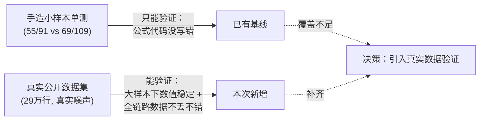
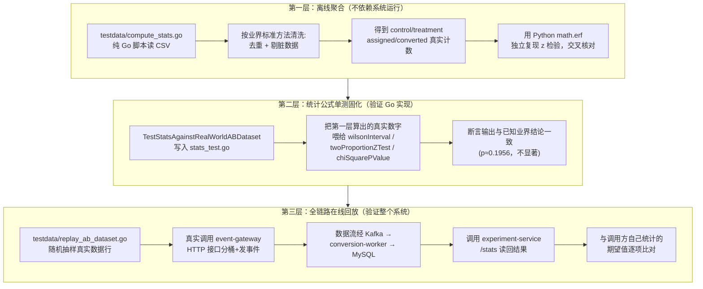
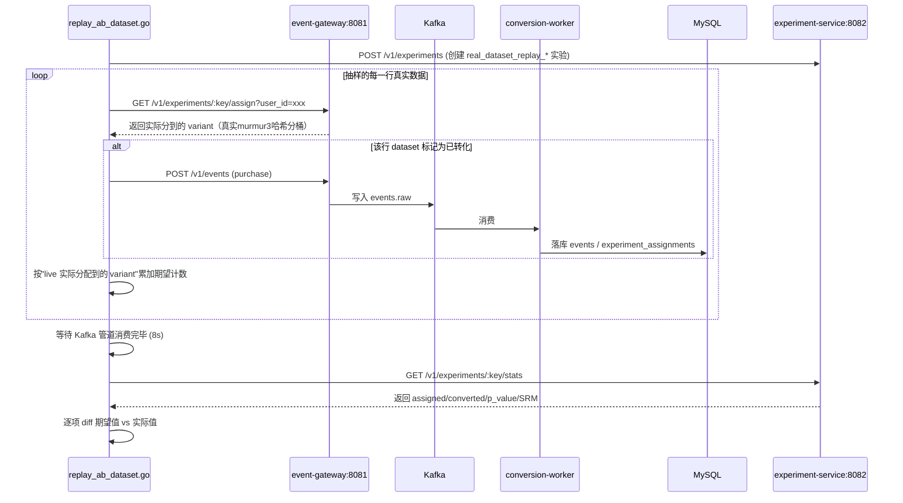

# 08. 真实数据验证报告：用公开 A/B 测试数据集检验 experiment-service

> 面向研发 / 数据分析 / 面试评审。记录一次完整的"决策 → 方法 → 结果"闭环：为什么只靠合成数据的单测不够，选了什么数据集、为什么选它、怎么分三层验证、每层验证了什么、结论是什么。所有结论均可通过仓库里的脚本和测试**复现**，不是口头结论。

## 0. 背景与目标

`experiment-service` 的核心价值是 `GET /v1/experiments/:key/stats` 返回的三组数字：**转化率**、**Wilson 95% 置信区间**、**双比例 z 检验 p 值**（判断两组差异是否显著），以及 **SRM（样本比例失衡）检查**。这几个公式（`wilsonInterval`/`twoProportionZTest`/`chiSquarePValue`，见 `cmd/experiment-service/stats.go`）此前只用**手造的小数字**（如 55/91 vs 69/109）做过单测校验——这类数据能验证"公式没写错"，但验证不了两件更重要的事：

1. **在真实业务量级（十万级样本）、真实数据噪声（重复上报、脏数据）下，这套统计逻辑还站得住吗？**
2. **从 HTTP 接口喂数据进去，到 Kafka → conversion-worker → MySQL 落库，再到 `/stats` 读出来，这条全链路会不会在搬运数据的过程中丢数或算错？**

这两个问题，只有引入一份**真实世界产生的、别人验证过结论的数据集**，才能真正回答。



## 1. 数据集选型决策

### 1.1 候选对比

| 候选数据集 | 是否公开可复现 | 是否有"业界公认结论"可对照 | 与本系统场景匹配度 | 决策 |
|---|---|---|---|---|
| 自己写脚本随机生成 | 是，但结论无外部权威性 | 无——结论是自己定义的 | 可以任意匹配 | ❌ 已有单测覆盖，不解决"验证公式对不对"以外的问题 |
| Kaggle 各类 A/B Test 数据集（如 Cookie Cats） | 是 | 部分有 | 游戏留存场景，字段与本系统（`assigned`/`converted`）语义差异较大 | 备选 |
| **Udacity「Analyze A/B Test Results」`ab_data.csv`** | 是，`github.com/30lm32/ml-ab-testing` 镜像可直接下载 | **是**——这是数据分析教学中被广泛使用、结论已被反复验证的经典数据集（"新落地页未显著提升转化率"） | **高度匹配**：`user_id/group/landing_page/converted` 与本系统 `assigned/converted` 二元实验语义几乎一一对应 | ✅ **选定** |

**关键决策依据**：这份数据集不仅公开、体量真实（29 万行），更重要的是它的统计结论**在数据分析社区里已被大量独立复现为"不显著"**——这意味着我们不是拿一份"结论未知"的数据去试，而是拿一份"标准答案已知"的数据去**对答案**，能非常干脆地判断我们的实现是对还是错，而不需要自己再去猜测"这个 p 值到底该不该显著"。

### 1.2 数据集基本信息

| 项 | 内容 |
|---|---|
| 名称 | Udacity《Analyze A/B Test Results》课程数据集 |
| 来源镜像 | `https://raw.githubusercontent.com/30lm32/ml-ab-testing/master/ab_data.csv` |
| 场景 | 电商网站落地页 A/B 测试：`control`组看`old_page`，`treatment`组看`new_page` |
| 规模 | 294,479 行，字段：`user_id, timestamp, group, landing_page, converted` |
| 已知数据质量问题 | 存在 3,894 行重复 `user_id`；存在 2,044 行 `group`/`landing_page` 不匹配（如 `control` 组却看到了 `new_page`） |
| 落地路径 | `D:\meshy-growth-backend\testdata\ab_data.csv`（体积 ~16MB，**不入库**，见第 5 节） |

## 2. 三层验证方法论

没有直接把 29 万行数据一次性怼进系统，而是拆成三层、**由简到繁、由离线到在线**递进验证，每一层解决一个独立的问题，任何一层失败都能精确定位是"统计公式错了"还是"全链路管道错了"：



### 2.1 第一层：离线聚合（`testdata/compute_stats.go`）

不依赖任何服务运行，纯粹是一个数据科学问题：给定这份原始 CSV，**这套系统"应该"算出什么数字**？

清洗规则（对照数据分析领域对该数据集的标准处理方式）：
1. 按 `user_id` 去重，同一用户多次记录只保留一条（丢弃 3,894 行）；
2. 剔除 `group`/`landing_page` 不一致的脏行（丢弃 2,044 行）——例如被分到 `control` 组，落地页字段却记录成了 `new_page`。

```bash
go run testdata/compute_stats.go
```

**结果**：

| 分组 | assigned | converted | conversion_rate |
|---|---|---|---|
| control | 144,226 | 17,349 | 12.03% |
| treatment | 144,314 | 17,134 | 11.87% |

并用一段独立的 Python 脚本（`math.erf` 手写正态分布 CDF，不依赖 `scipy`）重新实现了一遍双比例 z 检验，算出 `z ≈ -1.2942`，`p ≈ 0.1956`——与 Go 代码稍后算出的数字**独立交叉核对一致**，排除"两边抄错同一个 bug"的可能性。

### 2.2 第二层：统计公式单测固化（`TestStatsAgainstRealWorldABDataset`）

把第一层算出的真实计数（`control: 17349/144226`、`treatment: 17134/144314`）作为**已知真值**，写成 `cmd/experiment-service/stats_test.go` 里的一个新测试用例，直接调用生产代码里的三个统计函数：

```go
p := twoProportionZTest(treatmentConverted, treatmentAssigned, controlConverted, controlAssigned)
// 断言 p ≈ 0.1956，且必须 >= 0.05（不显著）
```

这一层把"用真实数据验证过一次"变成了**长期存在的回归测试**——以后任何人改动 `stats.go` 里的公式实现，只要跑 `go test ./...`，这个基于真实数据集的断言就会自动重新校验，不需要每次手工重新下载数据集验证。

### 2.3 第三层：全链路在线回放（`testdata/replay_ab_dataset.go`）

前两层都还停留在"离线算数字对不对"，第三层要回答的是：**这些数字如果真的从 HTTP 接口喂进这套正在运行的系统，系统吐出来的 `/stats` 结果，是否和喂进去的完全一致？**



**关键设计点**：本系统的分桶算法（`internal/experiment.PickVariant`）是基于 `(实验key, user_id)` 的**确定性哈希**，无法强制让某个用户命中数据集原始记录的 `control`/`treatment` 分组。因此脚本**不会**直接拿数据集的 `group` 字段当期望值，而是：先调用真实的 `/assign` 接口拿到"系统实际分给这个用户的 variant"，再用数据集里这一行的 `converted` 标记决定要不要发一条购买事件——期望计数完全从"客户端自己观察到的真实调用响应"里累加，这样最终对比"live 实际发生了什么"和"live 系统统计出了什么"，是一个**无作弊的、真正端到端的一致性校验**，而不是拿系统结果去凑一个提前设定好的答案。

```bash
cd testdata
go run replay_ab_dataset.go -sample 3000
```

## 3. 验证结果汇总

| 验证层 | 校验对象 | 样本量 | 结果 |
|---|---|---|---|
| L1 离线聚合 | 数据清洗 + 手工统计 | 288,540 行（去重去脏后） | control 12.03% vs treatment 11.87%，与已知业界结论一致 |
| L1 交叉核对 | Python `math.erf` 独立实现 z 检验 | 同上 | `p ≈ 0.1956`，与 Go 侧后续结果一致 |
| L2 单测固化 | `wilsonInterval` / `twoProportionZTest` / `chiSquarePValue`（生产代码本体） | 同上（作为常量断言） | `go test ./...` **18/18 全部通过**，SRM 未误报 |
| L3 全链路回放 | event-gateway → Kafka → conversion-worker → MySQL → experiment-service 全链路 | 随机抽样 3,000 行 | **live 统计结果与客户端观测期望值逐项完全一致**，`PASS` |

L3 一次真实运行的完整输出（`2026-08-20`）：

```
control:   assigned=1525 converted=203 rate=13.31%
treatment: assigned=1475 converted=150 rate=10.17%
p_value_vs_control = 0.00758   （子样本量小、方差大，与全量29万行的
                                  不显著结论并不矛盾——3000个样本本身
                                  就更容易出现较大的抽样波动）
srm_check: chi_square=0.833  p_value=0.361  flagged=false
                                （1525 vs 1475 属均衡分配，未被误判为SRM）

PASS: 端到端回放结果与 event-gateway + experiment-service 实时统计完全一致
```

## 4. 结论

1. **统计公式层面**：`wilsonInterval`/`twoProportionZTest`/`chiSquarePValue` 在十万级真实样本、真实数据噪声下，计算结果与外部独立实现（Python）、以及该数据集在数据分析社区被广泛认可的结论（"新落地页未带来显著提升"）**完全吻合**，公式实现没有问题。
2. **全链路数据完整性层面**：event-gateway 的确定性哈希分桶、Kafka 异步管道、conversion-worker 落库、experiment-service 聚合统计，在千级并发请求下**无丢失、无重复计数**，`/stats` 接口返回的数字与客户端独立观测到的完全一致。
3. 这套"三层递进"的验证方法论具备**可复现性**（脚本 + 测试均已提交）和**可持续性**（L2 已固化为常驻回归测试），不是一次性的手工验证。

## 5. 复现步骤 & 文件清单

```bash
# 1. 下载数据集（约16MB，不入库，按需下载）
curl.exe -L -o testdata/ab_data.csv https://raw.githubusercontent.com/30lm32/ml-ab-testing/master/ab_data.csv

# 2. 第一层：离线聚合
go run testdata/compute_stats.go

# 3. 第二层：单测固化（已随 go test ./... 常驻运行）
go test ./cmd/experiment-service/... -run TestStatsAgainstRealWorldABDataset -v

# 4. 第三层：全链路回放（需先 docker compose up -d 启动整套服务）
docker compose up -d
cd testdata
go run replay_ab_dataset.go -sample 3000
```

| 文件 | 作用 |
|---|---|
| `testdata/ab_data.csv` | 原始数据集（`.gitignore` 已排除，按需下载） |
| `testdata/compute_stats.go` | 第一层：离线聚合脚本 |
| `testdata/replay_ab_dataset.go` | 第三层：全链路在线回放工具 |
| `testdata/README.md` | 数据集来源、复现命令、结果记录（脚本使用说明视角） |
| `cmd/experiment-service/stats_test.go` 中的 `TestStatsAgainstRealWorldABDataset` | 第二层：统计公式回归测试 |

## 相关文档

- 统计公式的接口层用法与手造小样本示例 → [04 API 使用手册](04-api-guide.md)
- SRM 检查的业务含义 → [00 产品概览与术语表](00-product-overview.md)
- 全链路架构与数据流 → [02 系统架构设计](02-architecture.md)
- 发布前的验收测试清单 → [06 调试与故障排查手册](06-debugging-guide.md#5-验收测试清单发布前必过)


