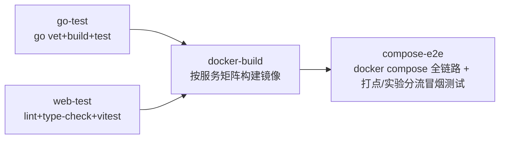

# 09. CI/CD 镜像构建与测试流水线

> 面向研发 / SRE。本文档描述本项目新增的可复用 GitHub Actions 流水线，覆盖大厂上线前通用的"构建 → 镜像打包/镜像仓库 → 测试"三段式流程，并说明如何在本机复现每一步（不依赖 GitHub 也能跑通）。

## 0. 为什么要有这条流水线

在这条流水线之前，本项目的"验证代码没坏"完全靠本地手动执行 `go build/vet/test`、`docker compose build/up`，没有任何自动化门禁——PR 合并前无法保证：

- 有没有引入编译错误 / vet 警告；
- admin-web 有没有 lint / 类型错误；
- 每个服务的 Docker 镜像能不能构建成功；
- `docker compose up` 起来的全链路（event-gateway → Kafka → conversion-worker/pipeline-worker → experiment-service）是否还能跑通最基本的打点 + 实验分流流程。

新增的流水线把这些检查固化成 CI 门禁，任何 PR 必须全部通过才能合并，任何合入 `master` 的 commit 都会产出一份经过测试的、可追溯的镜像版本。

## 1. 文件与职责划分

```
.github/workflows/
├── build-test.yml   # 可复用流水线本体（workflow_call + workflow_dispatch）
└── ci.yml           # 触发器：push/PR 到 master 时调用 build-test.yml
```

拆成两个文件是为了让"流水线做什么"和"什么时候触发、以什么参数触发"解耦——未来如果要新增一个 `release.yml`（比如打 tag 发布），可以直接 `uses: ./.github/workflows/build-test.yml` 复用同一套 job，只是换一套触发条件和 `push_image` 参数，不需要重复写 job 逻辑。

## 2. 流水线阶段总览



| Job | 对应本地命令 | 覆盖范围 |
|---|---|---|
| `go-test` | `go mod tidy && go vet ./... && go build ./... && go test ./... -race -covermode=atomic` | 7 个 Go 服务 + `internal/*` 共享包 |
| `web-test` | `npm ci && npm run lint && npm run type-check && npm run test -- --run` | `admin-web`（Next.js + Vitest） |
| `docker-build` | `docker build --build-arg SERVICE=<svc> .` / `docker build ./admin-web` | 按 matrix 对 8 个可构建镜像（7 个 Go 服务 + admin-web）逐一构建，**任何一个构建失败都会让该 job 失败**，但不影响其他镜像并行构建（`fail-fast: false`） |
| `compose-e2e` | `docker compose build && docker compose up -d && docker compose run --rm seed` + 健康检查 + 打点/实验分流 curl | 端到端验证，等价于 [03 快速上手教程](03-quickstart.md) 的第 2-8 步 |

依赖关系：`docker-build` 依赖 `go-test` + `web-test` 全部通过；`compose-e2e` 依赖 `docker-build` 全部通过。任何早期阶段失败，后面阶段不会执行，避免在明知代码编译不过的情况下浪费时间构建镜像、起容器。

## 3. 镜像标签与"镜像仓库"策略

`docker-build` job 里每个服务的镜像都会打两个 tag：

```
ghcr.io/<owner>/<repo>/<service>:<git-sha前12位>
ghcr.io/<owner>/<repo>/<service>:latest
```

- **PR 触发**：只构建镜像做验证（`push_image=false`），不推送到任何仓库——PR 阶段不需要产出可追溯的镜像，只需要确认"能构建成功"。
- **push 到 `master` 触发**：`push_image=true`，构建成功后推送到 GitHub Container Registry（GHCR），使用仓库自带的 `GITHUB_TOKEN`（`packages: write` 权限），不需要额外配置密钥。这就是产品经理/发布流程里常说的"镜像仓库/镜像分发"环节——发布时可以直接按 commit SHA 拉取一个**已经跑过全部测试**的镜像，而不是本地重新构建。

> 选择 GHCR 而不是 Docker Hub：GHCR 与仓库同属一个 GitHub 账号体系，`GITHUB_TOKEN` 自带推送权限，不需要额外注册/配置 Secrets，最贴近"零额外配置就能跑通"的目标。如果团队已有私有镜像仓库（Harbor/ECR/ACR），只需要把 `ci.yml` 里 `image_registry` 输入换成对应地址，并把登录凭据配置为对应的 Secrets 即可，`build-test.yml` 本身不需要改动。

## 4. GOPROXY / 镜像拉取的网络问题与解决方式

本项目开发机所在网络环境下，直接拉取 `proxy.golang.org`（Go 模块）和部分 `gcr.io` 镜像层可能变慢或失败。流水线和本地复现命令因此做了如下处理：

- **Go 模块代理**：`build-test.yml` 中 `GOPROXY` 通过仓库/组织级变量 `vars.GOPROXY` 覆盖，默认值是官方 `https://proxy.golang.org,direct`（GitHub-hosted runner 网络通畅，用官方源即可）。如果你在受限网络的自建 runner 上跑这条流水线，在仓库 Settings → Secrets and variables → Actions → Variables 里新增一个 `GOPROXY` 变量，值设为 `https://goproxy.cn,direct`（或公司内部代理），不需要改动 workflow 文件。
- **本地复现**（见下一节）沿用本项目已经在 `Dockerfile` 里使用的做法：`docker run ... -e GOPROXY=https://goproxy.cn,direct golang:1.25-bookworm ...`。
- **Docker base image**：`Dockerfile` 第二阶段用的 `gcr.io/distroless/base-debian12` 在网络受限环境下拉取可能较慢，如遇到超时，可以临时改用 `mirror.gcr.io/distroless/base-debian12`（Google 官方提供的公共只读镜像，路径与 `gcr.io` 完全一致，仅需替换域名前缀）作为过渡方案；GitHub-hosted runner 默认网络访问 `gcr.io` 没有这个问题，因此 CI 流水线本身不需要改。

## 5. 本机复现每个阶段（不依赖 GitHub Actions）

### 5.1 复现 `go-test`（本机没装 Go 工具链时）

```bash
cd meshy-growth-backend
docker run --rm -v ${PWD}:/src -w /src -e GOPROXY=https://goproxy.cn,direct golang:1.25-bookworm \
  sh -c "go mod tidy && go vet ./... && go build ./... && go test ./... -race -covermode=atomic -coverprofile=coverage.out"
```

（如果本机已装 Go 1.25+，直接去掉 `docker run` 包装，运行 `sh -c` 里的命令即可。）

### 5.2 复现 `web-test`

```bash
cd meshy-growth-backend/admin-web
npm ci
npm run lint
npm run type-check
npm run test -- --run
```

### 5.3 复现 `docker-build`（任选一个服务验证）

```bash
cd meshy-growth-backend
docker build --build-arg SERVICE=experiment-service -t meshy/experiment-service:local .
docker build -t meshy/admin-web:local ./admin-web
```

### 5.4 复现 `compose-e2e`

这一步就是 [03 快速上手教程](03-quickstart.md) 第二步到第八步的自动化版本：

```bash
docker compose build
docker compose up -d
docker compose run --rm seed
curl http://localhost:8081/healthz
curl -X POST http://localhost:8081/v1/events -H "Content-Type: application/json" \
  -d '{"event_name":"purchase","user_id":"ci-smoke-user","click_id":"ci-smoke-click","ad_platform":"meta","campaign_id":1,"properties":{"value":199}}'
docker compose down -v
```

## 6. 触发方式一览

| 事件 | 行为 |
|---|---|
| 对 `master` 发起 Pull Request | 跑完整流水线（`go-test`/`web-test`/`docker-build`/`compose-e2e`），**不**推送镜像 |
| 直接 push 到 `master`（或 PR 合并） | 跑完整流水线，`docker-build` 额外推送镜像到 GHCR |
| 手动触发（Actions 页面 → Run workflow，`build-test.yml` 支持 `workflow_dispatch`） | 可手动勾选 `push_image` 决定是否推送，用于调试流水线本身或临时补发镜像 |

`ci.yml` 里配置了 `concurrency` 分组（按分支/工作流分组，新提交自动取消同分支上排队中的旧运行），避免同一个分支连续 push 时堆积多个重复的流水线实例浪费 runner 资源。

## 7. 与现有文档的关系

- 与 [01 建设 SOP · 阶段5 测试验证](01-build-sop.md#阶段-5测试验证) 的三层测试策略（单元→集成→E2E）一一对应：`go-test`/`web-test` = 单元测试层，`compose-e2e` = 端到端测试层；本流水线目前没有独立的"集成测试"job，是因为本项目当前的集成测试（Kafka at-least-once 语义验证等）仍是手动执行的排障演练（见 [06 调试手册](06-debugging-guide.md)），未固化为自动化用例——记录为后续 Roadmap。
- 与 [07 发布与运维手册](07-release-ops.md) 的关系：07 文档里"本项目目前没有镜像仓库，回滚靠本地重新构建"这一已知局限，在本流水线上线后已经**部分缓解**——`master` 分支的每次 commit 现在都会产出并推送一个带 SHA tag 的镜像到 GHCR，回滚时可以直接 `docker pull ghcr.io/.../<service>:<上一个稳定sha>` 而不必重新编译。07 文档中"生产化建议"章节里"发布看板记录当前跑的是哪个 commit/镜像版本"这一条，现在有了具体的镜像 tag 可以对上。

## 8. 已知限制（诚实标注，不要误以为已具备）

- `docker-build` 只验证"镜像能否构建成功"，不做镜像漏洞扫描（Trivy/Grype 等），也不做镜像大小/层数优化检查——如需要，可以在 `build-test.yml` 的 `docker-build` job 里追加一个扫描步骤。
- `compose-e2e` 是冒烟测试（happy path），不是完整回归测试；覆盖"打点入队成功"和"实验分流可分组"两个最核心的用户故事，不覆盖转化回传重试、SRM 检测等更细的业务逻辑（这些已有对应的 Go 单元测试覆盖，见 `go-test` 阶段）。
- 镜像推送目标固定为 GHCR；若要切换到其他镜像仓库，需要同步修改 `ci.yml` 的 `image_registry` 输入和登录凭据来源（见第 3 节）。
- 尚未接入自动回滚 / 灰度发布能力，这部分与 [07 发布与运维手册](07-release-ops.md) 中记录的 Roadmap 一致，本流水线只解决"构建 + 测试 + 出镜像"，不解决"怎么把镜像安全地发布到生产"。
