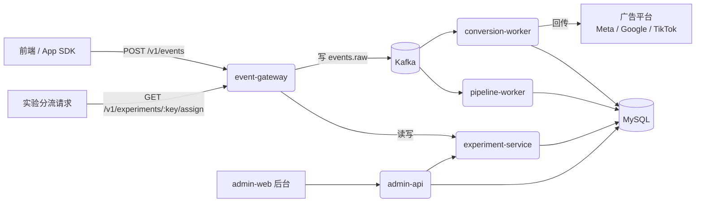

# meshy-growth-backend 文档中心

> 维护人：增长后台产品 & 研发团队　|　最近更新：2026-08-15　|　文档状态：`Active`

本目录是 **meshy-growth-backend**（事件追踪 / 广告转化回传 / A-B 实验平台）项目的完整文档集，按大厂通用的"从0到1建设 SOP"组织，覆盖立项、设计、开发、测试、上线全流程，并附使用教程与调试手册。

## 文档地图

| 编号 | 文档 | 面向读者 | 一句话说明 |
|---|---|---|---|
| 00 | [产品概览与术语表](00-product-overview.md) | 全员 | 这个系统是什么、解决什么问题、名词对齐 |
| 01 | [系统建设 SOP](01-build-sop.md) | PM / TL / 研发 | 从需求评审到上线复盘的标准流程，含各阶段交付物模板 |
| 02 | [系统架构设计](02-architecture.md) | 研发 / 架构 | 服务拆分、数据流、技术选型理由，含架构图 |
| 03 | [快速上手教程](03-quickstart.md) | 新人 / 使用方 | 10 分钟从零跑通整套系统（图文步骤） |
| 04 | [API 使用手册](04-api-guide.md) | 前端 / 集成方 | 每个接口的用途、请求/响应示例、错误码 |
| 05 | [后台管理界面操作手册](05-admin-web-guide.md) | 运营 / 增长同学 | admin-web 每个页面怎么用、能看到什么 |
| 06 | [调试与故障排查手册](06-debugging-guide.md) | 研发 / on-call | 分服务的排障 SOP、常见故障树、日志速查表 |
| 07 | [发布与运维手册](07-release-ops.md) | 研发 / SRE | 灰度发布、优雅重启、回滚、监控看板 |

## 30 秒读懂这个系统

一句话：**用户行为事件从前端打到 `event-gateway`，经 Kafka 异步分发给"转化回传"和"数据管道"两条流水线；同时 `experiment-service` 负责 A/B 实验分流与统计；`admin-web` 是给运营/增长同学看数据、建实验的后台。**

## 如何使用本文档集

- **我是新加入的同学，想先跑起来看看** → 直接看 [03 快速上手教程](03-quickstart.md)
- **我要接入这套系统打点或做实验** → 看 [04 API 使用手册](04-api-guide.md)
- **我要给自己团队复刻一套类似系统** → 从 [01 建设 SOP](01-build-sop.md) 开始，按阶段抄作业
- **线上报警了 / 数据对不上** → 直接跳 [06 调试与故障排查手册](06-debugging-guide.md)
- **我要做发布 / 扩容 / 重启** → 看 [07 发布与运维手册](07-release-ops.md)
